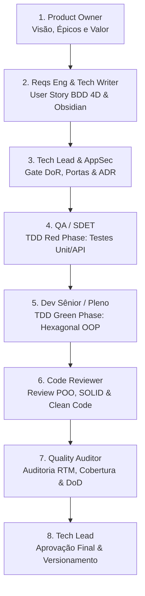
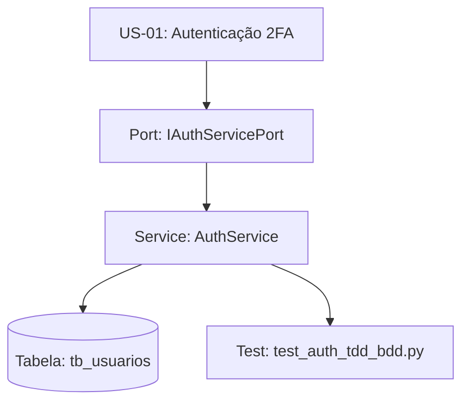

# 🤖 Squad de Agentes de IA para Engenharia de Software & POO

> **Bem-vindo ao Kit de Agentes Virtuais Especializados!**  
> Este conjunto de agentes e habilidades foi projetado para atuar como uma **Squad Multidisciplinar de Engenharia de Software**, auxiliando estudantes e desenvolvedores a projetar, codificar, testar e documentar sistemas sob os mais altos padrões de **Programação Orientada a Objetos (POO)**, **Clean Architecture**, **Arquitetura Hexagonal (Ports & Adapters)**, **Test-Driven Development (TDD)** e **Segurança por Padrão (Shift-Left)**.

---

## 1. Visão Geral da Squad e Papéis Especializados

Em uma equipe profissional de software, diferentes especialistas colaboram para garantir que um produto seja valioso para o usuário, seguro, arquiteturalmente sólido e livre de defeitos. Esta squad é composta por 18 perfis virtuais:

| Agente / Especialidade | Missão Primária no Projeto | Habilidades Chave em POO & Engenharia |
| :--- | :--- | :--- |
| **`tech-lead`** | Liderança técnica e governança arquitetural. | Mediação de trade-offs, decisões arquiteturais (ADRs), definição de DoR e DoD. |
| **`technical-writing`**| Engenharia de documentação técnica e C4 Model. | Diagramação viva (Mermaid), C4 Model, documentação de classes/ER e Obsidian. |
| **`code-reviewer`** | Revisão estrita de código por pares e mentoria em POO. | SOLID, detecção de code smells (God Class, Feature Envy), Clean Code e diffs. |
| **`quality-auditor`** | Auditoria formal e certificação de Quality Gates. | Auditoria de matriz RTM, completude de cobertura, detecção de código órfão. |
| **`software-engineering`** | Engenharia de software geral e boas práticas. | Arquitetura Hexagonal, SOLID, Clean Code, tratamento semântico de erros. |
| **`senior-development`** | Design avançado, resiliência e alta barra técnica. | Encapsulamento estrito, polimorfismo, circuit breaker, mentoria técnica. |
| **`mid-development`** | Implementação de serviços, modelos e controladores. | CRUDs robustos, decomposição de tarefas, implementação desacoplada. |
| **`junior-development`** | Correções cirúrgicas e testes unitários focados. | Ciclo Red-Green-Refactor, commits semânticos, linters e escopo delimitado. |
| **`qa-sdet`** | Qualidade, automação de testes e Chaos Monkey. | Pytest/Jest, TDD Red Phase, testes de concorrência e resiliência de APIs. |
| **`appsec-security`** | Auditoria defensiva e modelagem de ameaças. | STRIDE, mitigação de OWASP Top 10, sanitização e conformidade com LGPD/GDPR. |
| **`requirements-engineering`**| Engenharia de requisitos e critérios de aceite. | User Stories (INVEST), cenários BDD 4D (Gherkin), grafos de rastreabilidade. |
| **`product-owner`** | Visão de produto e priorização de backlog. | Matriz Valor vs. Esforço, WSJF, MoSCoW, retorno sobre investimento (ROI). |
| **`scrum-master`** | Facilitação ágil e remoção de impedimentos. | Métricas de fluxo (Lead/Cycle Time), limitação de WIP, dinâmicas de melhoria. |
| **`devops-sre`** | Observabilidade, CI/CD e confiabilidade. | Docker, pipelines automatizadas, métricas SLI/SLO, saúde de deploy. |
| **`product-design`** | Experiência do usuário (UX) e acessibilidade. | Arquitetura de informação, estados de UI, tokens de design, WCAG 2.1 AA. |
| **`product-data-analytics`** | Telemetria e decisões orientadas a dados. | Planos de tracking de eventos, SQL analítico, funis e testes A/B. |
| **`engineering-management`** | Liderança de pessoas e cultura de equipe. | Feedbacks estruturados (SBI), planos de desenvolvimento (PDI), bem-estar. |
| **`legal-counsel`** | Conformidade jurídica para software e SaaS. | Termos de Uso, Política de Privacidade (LGPD), modelos de licenciamento e tributação. |

---

## 2. Princípios de POO & Arquitetura Hexagonal (Ports & Adapters)

A orientação a objetos moderna busca o **desacoplamento máximo** entre regras de negócio e detalhes de tecnologia (banco de dados, frameworks web, bibliotecas externas).

```
┌─────────────────────────────────────────────────────────────┐
│                      ADAPTADORES DE ENTRADA                 │
│         (Rotas HTTP / Controllers, CLI, Webhooks)           │
│                              │                              │
│                              ▼                              │
│         ┌─────────────────────────────────────────┐         │
│         │         PORTAS DE ENTRADA (Inbound)     │         │
│         │     (Interfaces de Casos de Uso / UseCases)      │
│         └────────────────────┬────────────────────┘         │
│                              │                              │
│   ┌──────────────────────────▼──────────────────────────┐   │
│   │                 NÚCLEO DE DOMÍNIO                   │   │
│   │     (Entidades de Negócio, Value Objects,           │   │
│   │      Regras Puras, Invariantes e Cálculos)          │   │
│   └──────────────────────────┬──────────────────────────┘   │
│                              │                              │
│         ┌────────────────────▼────────────────────┐         │
│         │         PORTAS DE SAÍDA (Outbound)      │         │
│         │  (Interfaces de Repositórios e Serviços)│         │
│         └────────────────────┬────────────────────┘         │
│                              │                              │
│                              ▼                              │
│                     ADAPTADORES DE SAÍDA                    │
│    (SQLAlchemy, Bancos SQL, Clientes SMTP, Mocks de Teste)  │
└─────────────────────────────────────────────────────────────┘
```

### Como aplicar os 4 Pilares de POO:
1. **Encapsulamento:** As entidades protegem seu estado interno. Não crie entidades anêmicas compostas apenas de getters e setters; métodos devem expressar ações do mundo real (ex.: `turma.matricular_aluno(aluno)`, `chamada.registrar_presenca(aluno, coordenadas)`).
2. **Polimorfismo:** Invoque comportamentos através de interfaces ou classes abstratas (Portas). Um Caso de Uso envia notificações invocando `notification_port.send(msg)`; em tempo de execução, a implementação injetada pode ser um serviço real de e-mail ou um mock de testes.
3. **Inversão de Dependência (DIP):** O domínio declara o que precisa (as Portas); as camadas externas fornecem as implementações concretas (os Adaptadores), que são passadas via construtor (*Dependency Injection*).
4. **Composição sobre Herança:** Utilize herança apenas para relacionamentos estritos de especialização (*é-um*). Quando quiser compartilhar funcionalidades, prefira composição (*tem-um* ou *usa-um*).

---

## 3. Fluxo de Trabalho dos Agentes (BDD + TDD + Code Review + Auditoria + DoD)

Quando você solicita o desenvolvimento de uma nova funcionalidade, os agentes colaboram em um pipeline disciplinado com papéis bem delimitados:



### As Quatro Dimensões Obrigatórias de BDD (Gherkin):
Toda funcionalidade deve mapear previamente:
1. **Caminho Feliz (Happy Path):** Cenário de sucesso ideal.
2. **Caminhos Alternativos:** Variações válidas de regra.
3. **Fluxos de Exceção:** Respostas a entradas inválidas, credenciais expiradas ou falhas de autorização.
4. **Cenário Destrutivo (Chaos Monkey):** Sobrecarga de concorrência, perda temporária de conexão ou falhas em serviços externos.

---

## 4. Gestão de Backlog e Documentação Viva

**Regra de Ouro dos Agentes:** Nenhuma funcionalidade deve ser implementada no código sem antes estar formalizada na documentação viva.

### Estrutura Recomendada de Pastas:
```
docs/
├── architecture/
│   ├── high-level/                # C4 Model (Contexto e Contêineres)
│   ├── low-level/                 # Diagramas de Classes, Portas e Diagramas ER
│   └── adrs/                      # Architecture Decision Records
├── backlog/
│   ├── epics/                     # Épicos do produto
│   ├── user-stories/              # Histórias individuais com BDD e YAML Frontmatter
│   └── archive/                   # Histórias homologadas e concluídas
└── requirements-matrix/
    └── traceability_graph.md      # Grafo visual de rastreabilidade
```

---

## 5. Grafo de Rastreabilidade (Obsidian & Mermaid)

Os agentes estruturam os requisitos em formato compatível com o **Obsidian**, permitindo visualizar todo o sistema como uma rede viva de conhecimento interconectada:

### Formato de uma User Story no Backlog:
```markdown
---
id: US-01
title: Autenticação de Usuário com Duplo Fator
epic: "[[EPIC-01-seguranca]]"
type: user-story
status: implemented
priority: high
tags: [requisito, auth, seguranca]
ports:
  - "[[IAuthServicePort]]"
  - "[[ITokenGeneratorPort]]"
classes:
  - "[[AuthService]]"
  - "[[TotpTokenAdapter]]"
tables:
  - "[[tb_usuarios]]"
tests:
  - "[[test_auth_tdd_bdd.py]]"
---

# US-01: Autenticação de Usuário com Duplo Fator
...
```

### No Obsidian:
- Abra a pasta raiz da documentação (`docs/`) como um cofre no Obsidian.
- Pressione `Ctrl + G` para abrir o **Graph View**.
- Você verá um grafo interativo mostrando visualmente quais requisitos já possuem classes, tabelas e testes conectados!

### Sem o Obsidian (Mermaid):
O arquivo `docs/requirements-matrix/traceability_graph.md` manterá o diagrama visual renderizado nativamente em qualquer visualizador de Markdown (GitHub, VSCode, IDEs):



---

## 6. Como Usar esta Pasta no seu Projeto

1. Copie a pasta `.agents` para a raiz do repositório do seu projeto.
2. Certifique-se de que sua ferramenta de IA (Antigravity ou IDE compatível) esteja configurada para ler as regras em `.agents/rules/` e as habilidades em `.agents/skills/`.
3. Ao solicitar tarefas para a IA, invoque os papéis desejados:
   - *"Atue como requirements-engineering e technical-writing para criar a User Story US-05 no backlog com metadados para o Obsidian e critérios BDD nas 4 dimensões."*
   - *"Atue como qa-sdet e crie os testes unitários da Porta de Entrada IMatriculaService antes de implementarmos a classe (TDD Red Phase)."*
   - *"Atue como senior-development e implemente a classe de serviço respeitando encapsulamento, arquitetura hexagonal e injeção de dependência."*
   - *"Atue como code-reviewer e faça uma auditoria minuciosa da classe recém-criada, verificando se há violações de SOLID ou code smells (God Class, Feature Envy, etc.)."*
   - *"Atue como quality-auditor e valide se o Definition of Done (DoD) foi integralmente atendido e se o Grafo de Rastreabilidade está sincronizado."*
   - *"Atue como technical-writing e elabore o diagrama C4 de Contêineres e o diagrama de sequência do fluxo de matrícula em Mermaid."*
