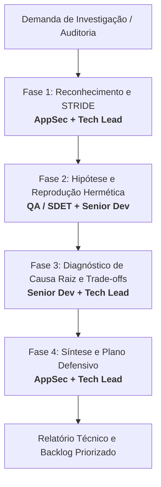
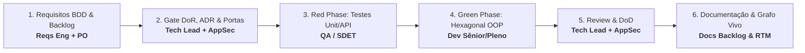

# Squad ChamadaE: Diretrizes de Orquestração, Skills e Multi-Perspectiva Monolítica

> **Status:** Ativo  
> **Escopo:** Projeto ChamadaE (Backend Flask, Frontend React, SQLite/PostgreSQL)  
> **Ambiente Operacional:** Estritamente Local / Branches de Desenvolvimento (`feature/*`)  
> **Política de Produção:** Proibição irrestrita de deploys diretos ou commits na branch `main`.  
> **Padrão de Execução:** Multi-Perspectiva Monolítica (Zero-Subagent Multi-Perspective) orientada a Skills locais.

---

## 1. Visão Geral da Squad e Mapeamento Dinâmico de Personas pelas Skills

O ChamadaE opera sob os princípios de **Clean Architecture**, **Orientação a Objetos (SOLID)**, **Test-Driven Development (TDD)** e **Segurança Shift-Left (SSDLC)**.

### Mapeamento Dinâmico de Personas:
As personas de análise, auditoria, revisão, planejamento e implementação **NÃO são estáticas nem dependem de múltiplos agentes físicos**: elas correspondem dinamicamente às **Skills disponíveis no diretório `.agents/skills/` deste workspace**.

| Skill / Perspectiva (`.agents/skills/`) | Responsabilidade Primária no Sistema | Foco de Atuação |
| :--- | :--- | :--- |
| **`tech-lead`** | Liderança técnica, estratégia arquitetural, governança DoR/DoD e mediação de decisões. | ADRs, desacoplamento, mediação de trade-offs, mentoria. |
| **`technical-writing`**| Engenharia de documentação técnica, C4 Model e governança de documentação viva. | Mermaid, C4 Model, documentação de classes/ER, manuais e Obsidian. |
| **`code-reviewer`** | Revisão estrita de código por pares, mentoria em POO e detecção de code smells. | SOLID, Clean Code, code smells (God Class, Feature Envy), diffs. |
| **`quality-auditor`** | Auditoria formal de qualidade, governança de RTM e certificação de Quality Gates. | Auditoria de matriz RTM, completude de cobertura, auditoria de débito técnico. |
| **`appsec-security`** | Auditoria estática/dinâmica, modelagem STRIDE, mitigação OWASP Top 10 e conformidade LGPD. | SAST, DAST, Broken Access Control, sanitização, criptografia. |
| **`requirements-engineering`**| Engenharia de requisitos funcionais/não-funcionais e critérios BDD/Gherkin. | User Stories, Gherkin, especificação formal, rastreabilidade. |
| **`product-owner`** | Visão de produto, priorização do backlog de valor e critérios de aceitação de negócio. | ROI, impacto educacional, priorização de entregas. |
| **`senior-development`** | Arquitetura de software, design patterns (GoF), resiliência e mentoria técnica. | Encapsulamento, polimorfismo, circuit breaker, idempotência. |
| **`mid-development`** | Implementação de serviços, modelos ORM, controladores REST e componentes React. | CRUDs resilientes, refatoração orientada a objetos, Clean Code. |
| **`junior-development`** | Implementação de correções de escopo delimitado, testes unitários e linter. | TDD assistido, cobertura de testes, correções cirúrgicas. |
| **`qa-sdet`** | Engenharia de qualidade, automação de testes de API/E2E, pirâmide de testes e Chaos Monkey. | Pytest, Playwright, testes destrutivos de concorrência, TDD Red Phase. |
| **`devops-sre`** | Observabilidade, pipelines de CI/CD, esteiras de testes e métricas de confiabilidade (SLOs). | GitHub Actions, dockerização, monitoramento de latência e erros. |
| **`prompt-engineer`** | Engenharia de prompts, decomposição de intenção e expansão de comandos alto/baixo nível. | Tradução de intenção humana, prompt chaining, desambiguação, templates DoR. |
| *(Demais skills locais)* | Especialidades complementares presentes em `.agents/skills/` (ex.: `legal-counsel`, `academic-scout`, `product-design`, `software-engineering`, etc.). | Ativadas conforme a natureza do problema. |

---

## 2. Fluxo Colaborativo 1: Investigação Técnica e Auditoria de Segurança

Utilizado em auditorias estáticas defensivas, resposta a incidentes, análise de vulnerabilidades ou investigação de anomalias lógicas.

### Protocolo Passo a Passo:
1. **Fase 1 — Reconhecimento e Mapeamento de Superfície de Ataque:**
   - **Agentes Ativos:** `appsec-security` (Líder) e `tech-lead`.
   - **Entrada:** Escopo do módulo sob investigação (ex.: fluxo de presença, autenticação, pagamentos).
   - **Ações:** Inspeção estática de código-fonte, rotas HTTP, decorators de autorização e modelos ORM.
   - **Saída:** Diagrama de Fluxo de Dados (DFD) e tabela de ameaças STRIDE.

2. **Fase 2 — Formulação de Hipóteses e Vetores de Teste:**
   - **Agentes Ativos:** `qa-sdet` e `senior-development`.
   - **Entrada:** Brechas lógicas identificadas na Fase 1.
   - **Ações:** Escrita de testes automatizados reprodutores (`pytest`) em ambiente isolado, simulando condições de borda, concorrência ou bypass sem impacto operacional.
   - **Saída:** Suíte de testes na fase vermelha (Red Phase) comprovando as fragilidades.

3. **Fase 3 — Diagnóstico Arquitetural de Causa Raiz:**
   - **Agentes Ativos:** `senior-development` e `tech-lead`.
   - **Entrada:** Resultados dos testes e rastreamento de código.
   - **Ações:** Identificar se a raiz é falha de modelo de domínio, falta de validação server-side, código acoplado ou ausência de controle de ciclo de vida.
   - **Saída:** Diagnóstico com avaliação de trade-offs arquiteturais (complexidade vs. segurança).

4. **Fase 4 — Síntese Defensiva e Matriz de Remediação:**
   - **Agentes Ativos:** `appsec-security` e `tech-lead`.
   - **Ações:** Consolidação do relatório técnico formal em `docs/` com classificação de severidade e backlog priorizado de mitigação em 3 horizontes (imediato, médio e longo prazo).

---

## 3. Fluxo Colaborativo 2: Desenvolvimento de Recursos e Correções via BDD/TDD

Utilizado para implementar novas funcionalidades, correções defensivas ou refatorações estruturais.

### Protocolo Passo a Passo:
1. **Fase 1 — Elicitação, Critérios BDD e Registro no Backlog:**
   - **Agentes:** `requirements-engineering` e `product-owner`.
   - **Ação Obrigatória:** Criar o arquivo `docs/backlog/user-stories/US-XX.md` com YAML Frontmatter compatível com Obsidian.
   - **Entrega:** Cenários Gherkin contemplando:
     - Caminho feliz (*Happy Path*).
     - Caminhos alternativos.
     - Casos de borda e exceção.
     - Caso destrutivo (*Chaos Monkey* - concorrência/queda de dependência).

2. **Fase 2 — Avaliação de Arquitetura, Hexagonal Ports e Gate DoR:**
   - **Agentes:** `tech-lead` e `appsec-security`.
   - **Aprovação DoR Obrigatória:** Contrato de API congelado, modelagem de dados sem vazamento de PII (LGPD), interfaces desacopladas por abstração de Portas (DIP) e registro de ADR em `docs/architecture/adrs/` se houver trade-offs.

3. **Fase 3 — TDD Red Phase (Primeiro os Testes):**
   - **Agentes:** `qa-sdet` e `senior-development`.
   - **Ação:** Criação da suíte `test_*.py` antes da implementação de qualquer código de produção. Execução do `pytest` confirmando falha controlada nos novos cenários.

4. **Fase 4 — TDD Green Phase (Implementação com Hexagonal OOP & Clean Code):**
   - **Agentes:** `senior-development`, `mid-development` ou `junior-development`.
   - **Ação:** Implementação focada em passar os testes, respeitando pilares de OOP e Arquitetura Hexagonal:
     - *Domínio Puro*: Entidades encapsuladas sem acoplamento a frameworks web ou ORMs.
     - *Portas e Adaptadores*: Casos de uso dependem de interfaces abstratas injetadas no construtor.
     - *Polimorfismo & DIP*: Inversão de dependência em integrações externas (e-mail, GPS, tokens).
     - *Alta Coesão e Baixo Acoplamento*: Rotas atuam apenas como adaptadores HTTP de entrada.

5. **Fase 5 — Code Review Cruzado, Gate DoD e Grafo de Rastreabilidade:**
   - **Agentes:** `tech-lead`, `senior-development` e `appsec-security`.
   - **Verificações DoD:**
     - [ ] 100% dos testes unitários e de integração verdes.
     - [ ] Zero avisos de compilação ou linter.
     - [ ] Sanitização de inputs contra injeção e XSS.
     - [ ] Idempotência e rollback transacional garantidos em falhas de banco.
     - [ ] Documentação Viva Sincronizada: Toda alteração (feature, bugfix, dívida técnica) possui item correspondente em `docs/backlog/` e no Grafo de Rastreabilidade (`docs/requirements-matrix/traceability_graph.md`).
     - [ ] Auditoria de RTM executada com sucesso (`python3 scripts/audit_rtm.py`), sem requisitos órfãos.

---

## 4. Matriz RACI de Responsabilidades da Squad

| Tipo de Tarefa | `tech-lead` | `technical-writing` | `code-reviewer` | `quality-auditor` | `appsec-sec` | `requirements` | `senior-dev` | `qa-sdet` |
| :--- | :---: | :---: | :---: | :---: | :---: | :---: | :---: | :---: |
| **Auditoria de Segurança / AppSec** | A | I | I | C | **R** | I | C | C |
| **Definição de Requisitos / BDD** | C | C | I | C | C | **R** | C | C |
| **Documentação Viva & Grafo Obsidian** | A | **R** | I | C | I | C | C | I |
| **Design de Arquitetura & ADRs** | **R** / A | C | C | I | C | I | C | I |
| **Criação de Testes TDD (Red)** | A | I | I | C | C | C | C | **R** |
| **Implementação de Código (Green)**| A | I | I | I | C | I | **R** | C |
| **Revisão de Código (POO & SOLID)** | A | I | **R** | I | C | I | C | C |
| **Auditoria de RTM & Gates DoR/DoD**| A | C | C | **R** | C | C | I | C |
| **Resiliência e Observabilidade** | A | I | I | C | I | I | C | C |

> Legenda: **R** = Responsável pela Execução | **A** = Aprovador Final | **C** = Consultado | **I** = Informado

---

## 5. Salvaguardas Operacionais e Limites de Segurança

1. **Ambiente Local e Branches Dedicadas:**
   - Nenhuma tarefa de investigação, refatoração ou testes deve operar na branch `main`.
   - Todas as modificações devem ser confinadas à branch de feature/desenvolvimento ativa (ex.: `feature/squad-improvements-bdd-tdd`).
2. **Deploy e Operações em Produção (VPS):**
   - Agentes podem executar rotinas de deploy, sincronização de bundles e reinício de serviços na VPS quando solicitados explicitamente pelo usuário, utilizando as credenciais e túneis SSH configurados na máquina local.
3. **Hermeticidade dos Testes:**
   - Testes não devem acessar serviços externos de produção (bancos Neon de produção, contas SMTP reais). Utilizar bancos de teste SQLite em memória ou instâncias efêmeras locais.
4. **Blindagem e Confinamento de Diretórios (Path Jail):**
   - Agentes e subagentes são estritamente confinados ao workspace `/home/julio/Documentos/projetos/ChamadaE`.
   - É proibido acessar, listar, modificar ou deletar pastas pessoais do usuário (`~/Documentos/` externos, `~/Downloads/`, `~/.ssh/`) e qualquer pasta de sincronização de nuvem (`~/Google Drive/`, `~/GoogleDrive/`, `~/gdrive/`, `~/Insync/`, `~/Dropbox/`, etc.).
   - Comandos destrutivos recursivos (`rm -rf`, `shred`, `truncate`) são proibidos; remoções devem ser cirúrgicas de arquivo único e apenas quando indispensáveis.

---

## 6. Governança de Eficiência, Economia de Tokens e Multi-Perspectiva Monolítica

Para maximizar a produtividade, profundidade analítica e velocidade da Squad sem esgotar cotas de contexto e tokens de LLM:

1. **Padrão Mandatório — Multi-Perspectiva Monolítica (Zero-Subagent Multi-Perspective):**
   - **Proibição Expressa:** Fica expressamente **proibido** disparar enxames em background (`invoke_subagent`, `/teamwork-preview`, sentinels ou crons de monitoramento) para tarefas de revisão, auditoria, crítica, planejamento ou análise técnica/pedagógica, a menos que o usuário ordene explicitamente a criação de subagentes.
   - **Execução Direta Local:** O agente principal DEVE assumir as diferentes perspectivas e papéis das Skills relevantes em uma **única sessão / chamada direta local**, eliminando duplicação de janelas de contexto e latência.
   - **Mapeamento Dinâmico por Skills:** As personas de análise e auditoria correspondem dinamicamente às Skills presentes em `.agents/skills/`. O agente principal identifica as skills pertinentes e encarna suas diretrizes sequencialmente.

2. **Formato Padrão das Análises Multi-Perspectiva:**
   - Ao emitir pareceres ou auditorias, a resposta deve estruturar claramente a contribuição de cada Skill adotada:
     - `### [Skill: nome-da-skill-1] — Perspectiva e Parecer`
     - `### [Skill: nome-da-skill-2] — Perspectiva e Parecer`
     - `### 🎯 Síntese Consolidada & Plano de Ação Objetivo`

3. **Exceção de Subagentes e Tiering de Modelos:**
   - Quando o usuário expressamente autorizar a criação de subagentes para tarefas isoladas ou de longa duração:
     - **`flash_lite` / `flash` (Mandatório):** Para leitura, pesquisa no codebase (`research`), verificação de lint/sintaxe, testes unitários e auditoria de requisitos/RTM.
     - **`inherit` / `pro` (Exclusivo):** Reservado para o orquestrador e tarefas de altíssima complexidade arquitetural ou algorítmica.

4. **Higiene de I/O em Ferramentas e Comunicação Direta:**
   - **Fatiamento Cirúrgico:** Utilizar `view_file` com `StartLine` e `EndLine` delimitados; nunca despejar arquivos com mais de 200 linhas inteiros.
   - **Busca por Padrões:** Usar `grep_search` com `MatchPerLine: false` antes de ler o conteúdo.
   - **Comandos Silenciosos:** Flags enxutas em testes (`pytest -q --tb=short`), git (`git status -s`) e builds.
   - **Eliminação de Ecos:** Respostas focadas e concisas, sem reproduzir trechos redundantes de artefatos que o usuário já visualiza.

