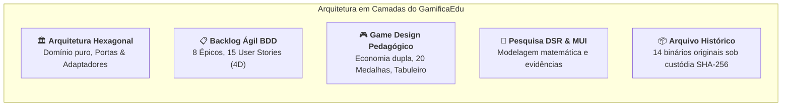

# Portal GamificaEdu — Centro de Documentação Técnica e Acadêmica

Bem-vindo ao centro oficial de documentação do **Portal GamificaEdu (Portal de Gamificação Educacional)**. Este repositório consolida todo o conhecimento de engenharia de software, decisões de arquitetura, backlog ágil, game design pedagógico e pesquisa científica desenvolvida no âmbito de uma Tese de Doutorado em Ciência da Computação baseada em **Design Science Research (DSR)**.

---

## 1. Visão Geral e Missão Pedagógica

O **Portal GamificaEdu** é um ambiente gamificado e **Sistema de Apoio à Decisão (SAD)** projetado para capacitar docentes a conceber, personalizar e aplicar atividades de aprendizagem interativas baseadas em tabuleiros e narrativas imersivas. O diferencial central da plataforma é o **Motor de Recomendação Contextual (MDC/MUI)**, que avalia a sinergia e o risco de elementos de jogos segundo evidências bibliométricas (SWEBOK, Bloom, Hexad e Teoria da Autodeterminação), prevenindo o *Dark Side* de gamificação através de vetos pedagógicos determinísticos.



---

## 2. Mapa Geral de Navegação da Documentação

A taxonomia viva de documentação está estruturada em cinco pilares fundamentais:

```
docs/
├── README.md                                  # Este Índice Mestre Navegável
│
├── architecture/                              # 🏛️ ARQUITETURA DE SOFTWARE & ENGENHARIA
│   ├── README.md                              # Sumário e visão geral da arquitetura
│   ├── adrs/                                  # 23 Decisões de Arquitetura (ADRs)
│   │   ├── README.md                          # Catálogo indexado de ADR-001 a ADR-023
│   │   ├── ADR-001-application-factory.md    # Padrão Application Factory no Flask
│   │   ├── ADR-002-activity-progress-tracking.md # Rastreamento granular por atividade
│   │   ├── ADR-003-step-based-content-architecture.md # Conteúdo por passo (stepId)
│   │   ├── ADR-004-xp-and-currency-separation.md # Separação de XP vitalício e Moedas
│   │   ├── ADR-005-backend-driven-effects-and-items.md # Efeitos e cosméticos backend-driven
│   │   ├── ADR-006-jsonb-mutation-flags.md    # Persistência de campos JSONB (flag_modified)
│   │   ├── ADR-007-bulk-delete-activities.md  # Rota atômica de exclusão em massa
│   │   ├── ADR-008-immersive-game-board-scene.md # Cena imersiva com Overlay Modal
│   │   ├── ADR-009-game-board-journey.md      # Tabuleiro visual de jogo interativo
│   │   ├── ADR-010-centralized-asset-preloading.md # Pré-carregamento de assets (useAssetLoader)
│   │   ├── ADR-011-container-presentational-wizard.md # Wizard em 8 etapas (Container/Presentational)
│   │   ├── ADR-012-custom-roulette-component.md # Roleta nativa em Canvas/CSS
│   │   ├── ADR-013-lifting-state-up-realtime.md # Lifting State Up para reatividade instantânea
│   │   ├── ADR-014-forum-vs-chat-separation.md # Separação Fórum (Assíncrono) vs Chat (Síncrono)
│   │   ├── ADR-015-centralized-analytics-telemetry.md # Telemetria centralizada (EventLog)
│   │   ├── ADR-016-lazy-loading-analytics-dashboard.md # Painel de análise com Lazy Loading
│   │   ├── ADR-017-smart-assignment-master-model.md # Lógica de Atribuição e Modelo Mestre
│   │   ├── ADR-018-flexible-completion-criteria.md # Passos obrigatórios versus opcionais
│   │   ├── ADR-019-academic-performance-coin-economy.md # Ganho de moedas atrelado a acertos
│   │   ├── ADR-020-cloudflare-tunnel-infra.md # Tunelamento via Cloudflare Tunnel
│   │   ├── ADR-021-multi-model-gemini-fallback.md # Estratégia Multi-Modelo Gemini com Fallback
│   │   ├── ADR-022-render-neon-cloud-stack.md # Stack Nuvem: Vercel + Render + Neon PostgreSQL
│   │   └── ADR-023-mvp-cosmetics-scope-cut.md # Definição de Escopo MVP e Feature Cut
│   ├── c4_context_container_diagrams.md       # C4 Nível 1 (Contexto) e Nível 2 (Contêineres)
│   ├── c4_component_hexagonal_backend.md      # C4 Nível 3 (Arquitetura Hexagonal: Portas & Adaptadores)
│   ├── data_model_erd.md                      # Dicionário de dados e ERD Mermaid (32 tabelas)
│   ├── contextual_recommendation_engine.md    # Motor de Recomendação Contextual (MDC/MUI/SAD)
│   ├── ai_multi_model_fallback.md             # Cascata Multi-Modelo Gemini com tolerância a falhas
│   ├── ai_draft_generation_pipeline.md        # Pipeline de IA e WebSockets (existente preservado)
│   └── squad_meetings_ai_pipeline_review.md   # Atas das 10 reuniões técnicas da squad
│
├── backlog/                                   # 📋 BACKLOG ÁGIL & HISTÓRIAS BDD
│   ├── README.md                              # Visão geral do backlog de produto e matriz geral
│   ├── epics/                                 # 8 Épicos de Produto
│   │   ├── EPIC-01-autenticacao-e-perfis.md
│   │   ├── EPIC-02-criacao-e-gestao-de-atividades.md
│   │   ├── EPIC-03-gestao-de-turmas-e-agendamento.md
│   │   ├── EPIC-04-execucao-gamificada-tabuleiro.md
│   │   ├── EPIC-05-comunicacao-forum-e-chat.md
│   │   ├── EPIC-06-economia-loja-e-roleta.md
│   │   ├── EPIC-07-analytics-e-telemetria.md
│   │   └── EPIC-08-orquestracao-de-conteudo-ia.md
│   └── user-stories/                          # 15 User Stories com YAML Frontmatter e 4D BDD
│       ├── US-01-login-e-recuperacao-senha.md
│       ├── US-02-perfil-e-coleta-demografica-pesquisa.md
│       ├── US-03-wizard-criacao-atividades-8-etapas.md
│       ├── US-04-motor-recomendacao-contextual-mrc.md
│       ├── US-05-gestao-de-turmas-e-codigo-ingresso.md
│       ├── US-06-agendamento-e-bloqueio-pos-prazo.md
│       ├── US-07-execucao-tabuleiro-e-conteudo-por-passo.md
│       ├── US-08-separacao-xp-vitalicio-e-moedas-loja.md
│       ├── US-09-catalogo-e-compra-itens-cosmeticos.md
│       ├── US-10-sistema-medalhas-e-conquistas.md
│       ├── US-11-roleta-diaria-da-sorte.md
│       ├── US-12-forum-moderado-e-categorias-automaticas.md
│       ├── US-13-chat-da-turma-tempo-real.md
│       ├── US-14-relatorios-desempenho-professor.md
│       └── US-15-geracao-rascunhos-ia-gemini.md
│
├── gamification/                              # 🎮 GAME DESIGN PEDAGÓGICO & ECONOMIA
│   ├── README.md                              # Sumário e princípios de design de jogos
│   ├── points_xp_levels.md                    # Economia Dupla (XP vs Moedas) e Curvas de Nível
│   ├── badges_catalog.md                      # Catálogo Oficial das 20 Medalhas (4 Categorias)
│   ├── reward_store_economy.md                # Loja de Cosméticos, Precificação e Efeitos Temporários
│   ├── game_board_mechanics.md                # Regras do Tabuleiro Interativo e Roleta Diária
│   └── pedagogical_heuristics_mda.md          # Teoria da Autodeterminação (SDT), MDA e Funil de Dados
│
├── academic/                                  # 🔬 PESQUISA CIENTÍFICA & DOUTORADO
│   ├── README.md                              # Sumário e visão científica da tese
│   ├── phd_context_and_methodology.md         # Metodologia Design Science Research (DSR) e Questões QP1-QP3
│   ├── mathematical_model_mui.md              # Especificação Algébrica e Dedução Matemática do MUI/SAD
│   ├── literature_evidence_matrix.md          # Matriz de Evidências Bibliométricas: SWEBOK e Bloom
│   ├── rpp_compilations_synthesis.md          # Síntese Histórica de Engenharia dos RPPs (01 a 80+)
│   └── latex/                                 # Fonte LaTeX da proposta de tese preservado
│       └── 5-propostav2.tex
│
└── archive/                                   # 📦 CUSTÓDIA HISTÓRICA & FORENSE
    ├── README.md                              # Manifesto de custódia com Hashes SHA-256 e Mapeamento
    └── repositorio_doutorado/                 # 14 arquivos binários originais (.docx, .pdf, .png)
        ├── Brainstorming de Itens para a Loja de Recompensas.docx
        ├── Compilado RPP 02.docx
        ├── Compilado RPP 03.docx
        ├── Compilado de Relatorios de Progresso do Projeto 01.docx
        ├── Documento de Design do Ambiente Gamificado.docx
        ├── Documento de Requisitos do Portal de Gamificação Educacional.docx
        ├── FunilReducaoPortal.png
        ├── Registro de Decisoes do Projeto (RDP01).docx
        ├── Relatório de Especificação Funcional.docx
        ├── Sistema de Medalhas e Conquistas.docx
        ├── diagramaMatematicaPortal.png
        ├── diagramaPortal.pdf
        ├── diagramaProfessorPortal.png
        └── diagrama_classes.pdf
```

---

## 3. Resumo Executivo das Seções

### 3.1 Arquitetura de Software e Engenharia (`docs/architecture/`)
- **[Catálogo Completo de 23 ADRs](architecture/adrs/README.md):** Histórico de decisões técnicas críticas desde a fundação até o deploy na nuvem.
- **[C4 Contexto e Contêineres](architecture/c4_context_container_diagrams.md):** Diagramas Mermaid Nível 1 e 2 apresentando as personas e a infraestrutura híbrida (Vercel, Render e Neon).
- **[C4 Componentes Hexagonais](architecture/c4_component_hexagonal_backend.md):** Decomposição em Inbound Adapters, Driving Ports, Núcleo de Domínio Puro, Driven Ports e Outbound Adapters.
- **[Modelo de Dados Relacional (ERD)](architecture/data_model_erd.md):** 32 tabelas normalizadas com suporte a campos JSONB, integridade referencial e auditoria forense.
- **[Motor de Recomendação Contextual](architecture/contextual_recommendation_engine.md):** Especificação algébrica de sinergia ($S_b$), risco ($P_c$), moduladores contextuais ($\mu$ e $\lambda$) e gatilho de veto pedagógico.
- **[Fallback Multi-Modelo Gemini](architecture/ai_multi_model_fallback.md):** Cascata de tolerância a falhas contra limites de taxa (HTTP 429) e grounding pedagógico via YouTube.

### 3.2 Backlog Ágil e Histórias de Usuário BDD (`docs/backlog/`)
- **[Visão Geral do Backlog](backlog/README.md):** 8 Épicos e 15 User Stories de alta granularidade.
- **Cobertura Quádrupla BDD:** Cada história contém 4 cenários Gherkin obrigatórios:
  1. *Caminho Feliz (Happy Path)*: Fluxo ideal executado com sucesso.
  2. *Fluxo Alternativo*: Regras complementares e variações de negócio válidas.
  3. *Fluxo de Exceção*: Validações de erro, bloqueios e códigos de resposta (400, 401, 403, 404, 422).
  4. *Teste Destrutivo (Chaos Monkey)*: Concorrência massiva, race conditions, injeção de scripts e tolerância a falhas.
- **Grafo de Rastreabilidade no Obsidian:** Metadados YAML Frontmatter conectando cada história a suas portas, classes de domínio, tabelas ORM e arquivos de teste.

### 3.3 Game Design e Economia Gamificada (`docs/gamification/`)
- **[Economia Dupla (XP vs Moedas)](gamification/points_xp_levels.md):** Separação de `total_xp_earned` (vitalício e monotônico para ranking) e `points_earned` (moedas gastáveis na loja).
- **[Catálogo Oficial de 20 Medalhas](gamification/badges_catalog.md):** Conquistas pedagógicas organizadas em Conclusão/Desempenho (7), Colaboração/Comunidade (4), Habilidade/Conhecimento (5) e Especiais/Engajamento (4).
- **[Economia da Loja de Cosméticos](gamification/reward_store_economy.md):** Molduras de avatar, cores de nome, títulos de prestígio e efeito temporário server-side "Topo por um Dia".
- **[Tabuleiro de Jogo e Roleta](gamification/game_board_mechanics.md):** Estados de nós, nós obrigatórios vs opcionais, overlay translúcido e mecânica de giro diário com giro extra imediato.
- **[Heurísticas e Framework MDA](gamification/pedagogical_heuristics_mda.md):** Teoria da Autodeterminação (SDT) e os 6 grupos de gamificação educacional.

### 3.4 Acervo Acadêmico e Pesquisa Científica (`docs/academic/`)
- **[DSR e Contexto do Doutorado](academic/phd_context_and_methodology.md):** Questões de pesquisa (QP1-QP3), constructos, modelo, método e instanciação.
- **[Dedução Matemática do MUI](academic/mathematical_model_mui.md):** Dedução passo a passo da fronteira de decisão, operadores Min-Max de segurança e normalização relativa.
- **[Matriz SWEBOK e Bloom](academic/literature_evidence_matrix.md):** Correlação cruzada de evidências bibliométricas para 4 áreas do SWEBOK e os 6 níveis da Taxonomia de Bloom.
- **[Síntese dos RPPs (01 a 80+)](academic/rpp_compilations_synthesis.md):** Histórico de evolução técnica registrado nos relatórios periódicos de progresso.
- **[Fonte LaTeX Preservado](academic/latex/5-propostav2.tex):** Texto original da proposta de tese de doutorado.

### 3.5 Arquivo Histórico e Custódia Criptográfica (`docs/archive/`)
- **[Manifesto de Custódia SHA-256](archive/README.md):** Tabela de integridade forense comprovando a preservação bit a bit dos 14 binários originais em `docs/archive/repositorio_doutorado/`.

---

## 4. Guia Rápido do Desenvolvedor (Quickstart)

### 4.1 Pré-requisitos
- Python 3.12+ com ambiente virtual `.venv` ativo.
- Node.js 20+ e npm para o frontend SPA.
- PostgreSQL ou conexão ativa com Neon PostgreSQL Serverless.

### 4.2 Inicialização do Ambiente
```bash
# Ativar o ambiente virtual Python
source .venv/bin/activate

# Executar a suíte de testes automatizados do backend
pytest

# Iniciar o ambiente de desenvolvimento integrado (Backend + Frontend)
./scripts/start_dev.sh
```

### 4.3 Verificação de Hashes do Arquivo Histórico
```bash
# Validar integridade dos arquivos binários preservados
sha256sum docs/archive/repositorio_doutorado/*
```
