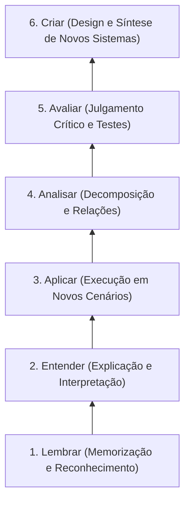

# Matriz de Evidências da Literatura: SWEBOK e Taxonomia de Bloom

Este documento compila a matriz de correlação cruzada entre o corpo de conhecimento da Engenharia de Software (**SWEBOK V3**), os níveis cognitivos da **Taxonomia de Bloom Revisada** e os elementos de gamificação mapeados no motor de recomendação.

---

## 1. Áreas de Conhecimento do SWEBOK V3 Integradas

A base de conhecimento bibliométrica do portal mapeia quatro áreas centrais do SWEBOK:
1. **Software Construction:** Foco em lógica de programação, sintaxe, algoritmos e testes unitários.
2. **Software Design:** Foco em arquitetura, diagramação UML, padrões de projeto (GoF) e Clean Code.
3. **Software Testing:** Foco em qualidade, criação de casos de teste, depuração e cobertura de código.
4. **Software Engineering Professional Practice:** Foco em trabalho em equipe, ética, liderança, comunicação e processos ágeis (Scrum/Kanban).

---

## 2. Matriz de Compatibilidade SWEBOK vs. Mecânicas de Jogo

| Área SWEBOK | Mecânicas com Alta Sinergia ($S_b^{puro} \ge 1.5$) | Mecânicas de Risco Crítico ($P_c^{puro} \ge 1.0$) | Justificativa Teórica |
|---|---|---|---|
| **Software Construction** | • Quizzes de código • Sistema de pontuação • Desafios com pressão de tempo moderada | • Pressão social agressiva • Escolhas forçadas arbitrárias | A fixação de sintaxe e lógica beneficia-se de repetição com feedback imediato; a pressão social em iniciantes trava o raciocínio. |
| **Software Design** | • Narrativas imersivas • Quebra-cabeças estruturais • Conquistas por elegância | • Competição individual estrita • Quizzes de memorização rasa | Design exige pensamento sistêmico e exploração; disputas de velocidade induzem a soluções espaguete de baixa qualidade. |
| **Software Testing** | • Caça a bugs (Bounty Hunting) • Estatísticas detalhadas • Medalhas de inspeção rigorosa | • Narrativas muito longas (fuga do foco prático) | O estudante de testes é impulsionado por encontrar anomalias e ter métricas claras de cobertura de código. |
| **Professional Practice** | • Cooperação e times • Fórum e mentoria • Chat em tempo real • Reconhecimento por pares | • Placares individuais de soma zero (Zero-Sum Games) | O trabalho profissional em engenharia é inerentemente coletivo; rankings individuais canibalizam a mentoria entre colegas. |

---

## 3. Integração com a Taxonomia de Bloom Revisada

A ordenação pedagógica dos parâmetros de esforço mental ($\omega$) apoia-se nos níveis de cognição de Bloom (Anderson et al., 2001):

- **Níveis Iniciais (Lembrar / Entender - $\omega_{base}$):** Quizzes rápidos, feedback imediato e pontuação direta.
- **Níveis Intermediários (Aplicar / Analisar - $\omega_{intermediario}$):** Quebra-cabeças lógicos, desafios de depuração de código e trilhas de nós em tabuleiro.
- **Níveis Avançados (Avaliar / Criar - $\omega_{maximo}$):** Projetos em equipe, discussões fundamentadas no fórum, revisão de pares e avaliação por rubricas formativas.
