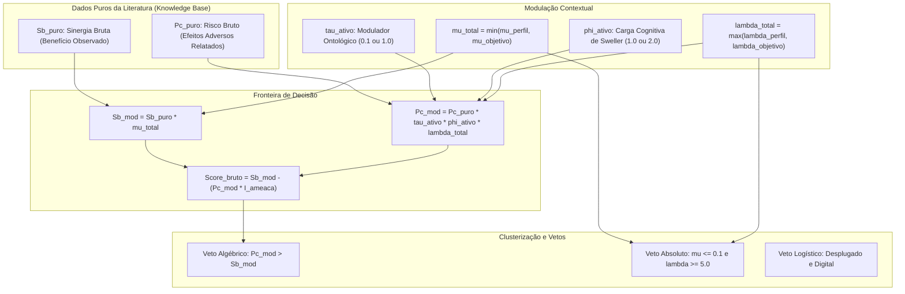

# Especificação Matemática e Dedução Algébrica do MUI (Modelo de Utilidade Instrucional)

Este documento apresenta a formulação matemática detalhada do **Modelo de Utilidade Instrucional (MUI)**, o núcleo de inferência algorítmica do Sistema de Apoio à Decisão (SAD) do **Portal GamificaEdu**.

---

## 1. Definição Formal do Vetor de Contexto ($V_{ctx}$)

O ambiente de aprendizagem é modelado por uma tupla de quatro variáveis:

$$V_{ctx} = \langle I_A, I_B, I_C, I_D \rangle$$

- $I_A \in \mathcal{K}_{SWEBOK}$: Área de conhecimento do corpo de conhecimento em Engenharia de Software (ex: Construção, Testes, Design, Prática Profissional).
- $I_B \in \{\text{teórico}, \text{prático}, \text{colaborativo}\}$: Foco instrucional ancorado na Taxonomia de Bloom revisada.
- $I_C \in \{\text{digital}, \text{desplugado}\}$: Restrição de infraestrutura e presença de dispositivos computacionais.
- $I_D \in \mathcal{P}_{Hexad}$: Perfil psicográfico predominante da turma segundo o modelo de Andrzej Marczewski (Competitivo, Cooperativo/Social, Realizador, Explorador).

---

## 2. Dedução Algébrica das Variáveis de Utilidade

Para cada elemento de jogo $j \in \mathcal{M}$ (conjunto de 28 mecânicas do SAD):

### 2.1 Sinergia Modificada ($S_b^{mod}$)
O potencial positivo de engajamento da mecânica é calibrado pelo fator de afinidade contextual:

$$S_b^{mod} = S_b^{puro} \times \mu_{total}$$

Onde $\mu_{total} = \min(\mu_{perfil}, \mu_{objetivo})$. A utilização do operador $\min$ garante uma postura analítica conservadora: a existência de qualquer desajuste pedagógico isolado anula bônus superficiais.

### 2.2 Risco Modificado ($P_c^{mod}$)
A probabilidade e o impacto de efeitos colaterais deletérios são dados por:

$$P_c^{mod} = P_c^{puro} \times \tau_{ativo} \times \phi_{ativo} \times \lambda_{total}$$

- $\tau_{ativo} \in \{0.1, 1.0\}$: Modulador de proteção ontológica. Narrativas e trilhas de conquista recebem $\tau = 0.1$ por serem intrinsecamente seguras; rankings públicos e disputas por eliminação recebem $\tau = 1.0$.
- $\phi_{ativo} \in \{1.0, 2.0\}$: Modulador da Teoria da Carga Cognitiva (Sweller). Quando a matéria possui alta densidade conceitual teórica E a mecânica impõe estresse temporal agudo, $\phi = 2.0$, dobrando o peso do risco.
- $\lambda_{total} = \max(\lambda_{perfil}, \lambda_{objetivo})$: Captura o atrito máximo de risco comportamental.

### 2.3 Supressão de Ruído e Score Bruto
Para evitar que penalidades puramente teóricas esmaguem elementos neutros inofensivos, aplica-se a função indicadora de ameaça orgânica $\mathbb{I}_{ameaca}$:

$$\mathbb{I}_{ameaca} = \begin{cases} 1, & \text{se } (P_c^{puro} > 0.1) \lor (\lambda_{total} > 1.0) \lor (\phi_{ativo} > 1.0) \\ 0, & \text{caso contrário} \end{cases}$$

O Score Bruto da mecânica é formalizado como:

$$Score_{bruto} = S_b^{mod} - \left(P_c^{mod} \times \mathbb{I}_{ameaca}\right)$$

---

## 3. Condições Formais de Veto Pedagógico

O modelo protege os estudantes contra o *Dark Side* de Gamificação aplicando três travas de segurança:

1. **Veto Algébrico:** Ocorre quando o risco ponderado da literatura supera numericamente o benefício:
   $$\text{Veto}_{alg} \iff (P_c^{mod} > S_b^{mod}) \land (P_c^{mod} > 0.1)$$
2. **Veto Heurístico Absoluto:** Disparado quando ocorre incompatibilidade psicopedagógica grave, mesmo que o elemento não tenha alto risco na literatura genérica:
   $$\text{Veto}_{abs} \iff (\mu_{total} \le 0.1) \land (\lambda_{total} \ge 5.0)$$
3. **Veto Logístico:** Incompatibilidade material com salas de aula analógicas:
   $$\text{Veto}_{log} \iff (I_C = \text{'desplugado'}) \land (\text{Elemento } j \in \mathcal{M}_{digital})$$

---

## 4. Normalização Relativa e Trava Anti-Inflação

Para apresentação ergonômica ao professor na escala visual $[-50, +50]$:

$$Score_{norm} = \left(\frac{Score_{bruto}}{\max(\{S_k \in \mathcal{S}_{validos} \mid S_k > 0\})}\right) \times 50$$

- **Trava de Relevância:** Se o teto absoluto do conjunto $\max(|S_k|) < 0.2$, adota-se teto unitário $1.0$. Isso impede a patologia estatística de inflar artificialmente uma mecânica medíocre para nota máxima quando todas as opções têm pontuações residuais.
- **Veto Logístico:** Força deterministicamente $Score_{norm} = -50.0$.
