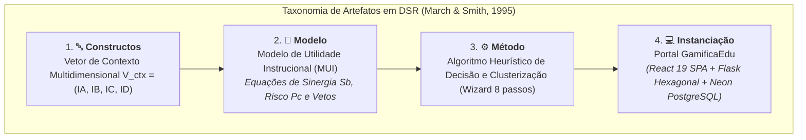

# Contexto Acadêmico do Doutorado e Metodologia Design Science Research (DSR)

Este documento contextualiza a fundamentação epistemológica e a metodologia científica que orientam o desenvolvimento do **Portal GamificaEdu**, desenvolvido no âmbito de uma Tese de Doutorado em Ciência da Computação, fundamentada na abordagem de **Design Science Research (DSR)**.

---

## 1. Problema de Pesquisa e Questões Epistemológicas

A gamificação em ambientes educacionais frequentemente enfrenta insucessos operacionais devido à aplicação descontextualizada de elementos de jogos (*one-size-fits-all*). Professores que não possuem formação em game design tendem a adotar mecânicas superficiais (pontos e placares) sem considerar as particularidades da disciplina e o perfil psicológico dos discentes, provocando o surgimento de efeitos colaterais adversos (**Dark Side da Gamificação**).

### Questões de Pesquisa (QP):
- **QP1:** Como modelar formalmente as variáveis contingenciais de contexto pedagógico (domínio do conhecimento, objetivo de aprendizagem, infraestrutura logística e perfil psicográfico dos estudantes) em um vetor computável?
- **QP2:** De que forma um motor de inferência matemática baseado em evidências bibliométricas da literatura pode apoiar os professores no processo de design de atividades gamificadas, prevenindo o Dark Side da Gamificação?
- **QP3:** Em que medida a instanciação de uma plataforma de software em arquitetura hexagonal com suporte a tabuleiros interativos e IA generativa orientada a rascunhos amplia a autonomia do docente e o engajamento dos estudantes?

---

## 2. Metodologia: Design Science Research (DSR)

A pesquisa segue o framework metodológico de DSR proposto por **March & Smith (1995)**, **Hevner et al. (2004)** e **Dresch et al. (2014)**, estruturando as contribuições acadêmicas em quatro classes formais de artefatos:

1. **Constructos:** O vocabulário e as representações simbólicas definidos para modelar o problema educacional. O constructo central é o **Vetor de Contexto ($V_{ctx}$)**, que decompõe o ambiente em quatro dimensões ortogonais: Área SWEBOK ($I_A$), Nível de Bloom ($I_B$), Logística Física/Digital ($I_C$) e Perfil Hexad ($I_D$).
2. **Modelo:** O **Modelo de Design Contextualizado (MDC)** e o **Modelo de Utilidade Instrucional (MUI)**, compostos pelo conjunto de equações algébricas que expressam as relações formais entre os constructos e balanceiam o benefício pedagógico versus o risco de atrito comportamental.
3. **Método:** O algoritmo passo a passo de inferência de utilidade, supressão de ruído estocástico, resolução de conflitos Min-Max e clusterização visual em três grupos na interface (Recomendados, Neutros e Não Recomendados).
4. **Instanciação:** O ambiente de software funcional **Portal GamificaEdu**, executado em nuvem (Vercel, Render e Neon) e validado empiricamente em salas de aula reais de cursos superiores de Computação.

---

## 3. Heurísticas Contingenciais vs. Heurísticas de Construção

Segundo Dresch et al. (2014), uma contribuição essencial em DSR reside na formulação de **Heurísticas Contingenciais**:
- Enquanto as *heurísticas de construção* orientam como o software deve ser codificado (ex: uso de Ports & Adapters, Application Factory, hooks customizados),
- As *heurísticas contingenciais* estabelecem as condições de contorno e aplicabilidade da teoria no mundo real (ex: *"SE o objetivo pedagógico for colaborativo E a turma contiver alunos vulneráveis à ansiedade, ENTÃO o uso de rankings competitivos DEVE ser vetado pedagogicamente"*).

---

## 4. Ciclos de Avaliação Empírica

O artefato foi submetido a rigorosos ciclos de avaliação formativa e somativa:
1. **Verificação de Coerência Teórica:** Análise de sensibilidade das equações algébricas e simulação computacional de múltiplos vetores de contexto antagônicos.
2. **Painel com Especialistas (Delphi):** Avaliação da matriz de pesos e coeficientes por professores doutores em Informática na Educação.
3. **Intervenção Piloto em Sala de Aula:** Aplicação de atividades em turmas de Engenharia de Software e Fundamentos de Programação, com coleta de telemetria forense (`event_log`) e testes de hipóteses sobre engajamento e retenção discente.
