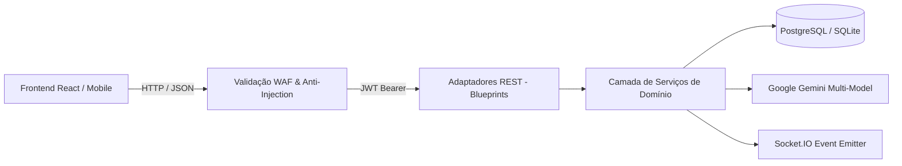

# Catálogo e Especificação das APIs REST — Portal GamificaEdu

> **Status:** Ativo & Atualizado  
> **Padrão:** RESTful JSON, Autenticação JWT (`Bearer`), WebSockets (Socket.IO)  
> **Base URL:** `/api`  
> **Cobertura:** 14 Blueprints e mais de 60 endpoints documentados  

---

## 1. Visão Geral da Arquitetura de APIs

As APIs do **Portal GamificaEdu** seguem o padrão arquitetural **Hexagonal (Ports & Adapters)**. As rotas HTTP atuam estritamente como adaptadores primários de entrada (*Inbound Adapters*), recebendo as requisições, validando schemas, extraindo identidades JWT e delegando as operações para os serviços de domínio em `backend/app/services/`.

---

## 2. Autenticação e Controle de Acesso (RBAC)

- **Cabeçalho Obrigatório:** `Authorization: Bearer <access_token>` (para rotas protegidas).
- **Perfis (Roles):**
  - `aluno`: Execução de atividades, tabuleiro, roleta, inventário, medalhas e fórum.
  - `professor`: Autoria de atividades, wizard com MDC, gestão de turmas, atribuições e relatórios.
  - `admin`: Console global, gestão de usuários, moderação, logs de segurança e métricas.
- **Tratamento Global de Erros:**
  - `400 Bad Request`: Payload JSON inválido ou campos obrigatórios ausentes.
  - `401 Unauthorized`: Token JWT ausente, inválido ou expirado.
  - `403 Forbidden`: Perfil insuficiente para a ação (RBAC) ou tentativa de IDOR/BOLA.
  - `404 Not Found`: Recurso inexistente.
  - `409 Conflict`: Violação de unicidade (ex: e-mail já cadastrado, matrícula duplicada).
  - `500 Internal Server Error`: Erro interno no servidor (respostas sanitizadas sem stack traces).

---

## 3. Matriz de Blueprints Registrados

| Blueprint | Prefixo Base | Descrição Funcional | Documentação Detalhada |
| :--- | :--- | :--- | :--- |
| **`auth_bp`** | `/api/auth` | Login, Registro, Google OAuth, Refresh, Perfil e Onboarding | [api_auth.md](api_auth.md) |
| **`activity_bp`** | `/api/activities` | CRUD de Atividades, Wizard, Clonagem, Publicação e Rascunhos | [api_activities.md](api_activities.md) |
| **`class_bp`** | `/api/classes` | Gestão de Turmas, Matrícula por Código e Atribuições | [api_classes.md](api_classes.md) |
| **`progress_bp`** | `/api/progress` | Progresso do Aluno no Tabuleiro, Resposta de Passos e Roleta | [api_progress.md](api_progress.md) |
| **`analytics_bp`** | `/api/analytics` | Relatórios de Desempenho do Professor e Telemetria Científica | [api_analytics_admin.md](api_analytics_admin.md) |
| **`admin_bp`** | `/api/admin` | Console Administrativo, Gestão de Usuários e Exportação de Logs | [api_analytics_admin.md](api_analytics_admin.md) |
| **`content_editor_bp`** | `/api/content_editor` | Editores Especializados de Quiz, Narrativa e Markdown | [api_content_and_social.md](api_content_and_social.md) |
| **`medals_bp`** | `/api/medals` | Catálogo das 20 Medalhas e Desbloqueio de Insígnias | [api_content_and_social.md](api_content_and_social.md) |
| **`rankings_bp`** | `/api/rankings` | Placares de Líderes por Turma e Disciplina | [api_content_and_social.md](api_content_and_social.md) |
| **`forum_bp`** | `/api/forum` | Fórum Assíncrono com Tópicos e Respostas por Passo | [api_content_and_social.md](api_content_and_social.md) |
| **`chat_bp`** | `/api/chat` | Mensagens de Bate-Papo da Turma em Tempo Real | [api_content_and_social.md](api_content_and_social.md) |
| **`contact_bp`** | `/api/contact` | Canal de Suporte e Mensagens Institucionais | [api_content_and_social.md](api_content_and_social.md) |
| **`student_bp`** | `/api/student` | Visão e Agrupamento de Atividades Atribuídas ao Aluno | [api_progress.md](api_progress.md) |
| **`log_bp`** | `/api/log` | Registro Direto de Eventos do Cliente | [api_analytics_admin.md](api_analytics_admin.md) |
| **Público & Health** | `/api/public`, `/api/health` | Estatísticas da Home, Contador de Acessos e Health Check SRE | [api_auth.md](api_auth.md) |

---

## 4. WebSockets e Comunicação Bidirecional (`Socket.IO`)

Além das rotas HTTP, o servidor disponibiliza os seguintes namespaces e canais de evento:

- **Namespace `/` (Default):**
  - Evento `join_room`: Insere o cliente na sala da turma (`class_<id>`) ou da atividade (`activity_<id>`).
  - Evento `send_message`: Propaga mensagens de chat instantâneas para os membros da turma.
  - Evento `ai_generation_progress`: Transmite em streaming as etapas de geração de rascunhos de IA (Google Gemini).
