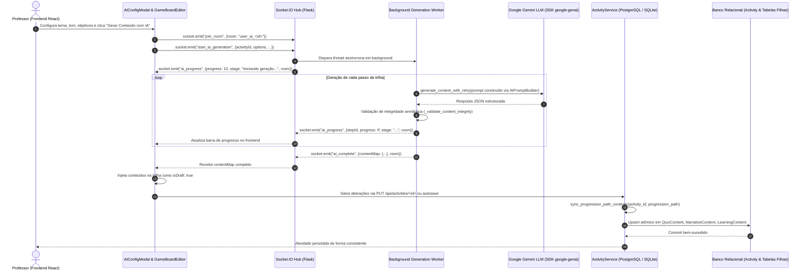

# Arquitetura do Pipeline de Geração de Rascunhos por IA (Narrativa, Quiz e Conteúdo)

## 1. Visão Geral Executiva

O subsistema de Geração de Rascunhos por Inteligência Artificial do **Portal Gamificação Educacional** permite que professores elaborem rapidamente atividades pedagógicas gamificadas. O usuário define o contexto pedagógico e os objetivos de aprendizagem, e o sistema orquestra modelos LLM Google Gemini para redigir rascunhos estruturados de:
1. **Roteiros Narrativos com Diálogos:** Histórias imersivas com cenários e falas entre personagens (mentores, alunos ou guias).
2. **Quizzes Gamificados:** Questões com alternativas, gabarito, pontuação e recompensas em moedas virtuais.
3. **Conteúdo Educacional de Apoio:** Textos em Markdown, referências de vídeo e links de estudo direcionados.

Este documento consolida a arquitetura ponta a ponta, os protocolos de rede em tempo real, as estratégias de persistência relacional, a máquina de estados e as correções arquiteturais implementadas.

---

## 2. Diagrama de Arquitetura e Fluxo de Dados Ponta a Ponta

---

## 3. Principais Falhas Diagnosticadas e Soluções Arquiteturais

### 3.1 Falha de Persistência Desacoplada (JSONB vs. Tabelas Relacionais)
- **Problema:** Quando o professor salvava a atividade após a IA gerar o roteiro (`contentMap`), o backend gravava o array de passos apenas no campo JSONB `Activity.gamification_design`, mas **não sincronizava as tabelas normalizadas filhas**:
  - `QuizContent` (`quiz_content`)
  - `NarrativeContent` (`narrative_content`)
  - `LearningContent` (`learning_content`)
  Como consequência, ao carregar a atividade para execução ou consultas relacionais, os conteúdos gerados pareciam vazios ou inexistentes.
- **Correção Arquitetural:**
  Implementada a função modular e idempotente `sync_progression_path_contents(activity_id, progression_path)` em `backend/app/services/activity_service.py`.
  A sincronização foi integrada no fluxo de:
  - `create_activity` (criação ou promoção do rascunho)
  - `update_activity` (atualização padrão via wizard ou tabuleiro)
  - `update_activity_structure` (salvamento de nós e arestas do tabuleiro)
  - `save_autosave` (salvamento em background a cada alteração)

### 3.2 Isolamento de Salas WebSocket (`room_id`)
- **Problema:** Em `backend/app/services/ai_service.py`, emissões de progresso intermediário (`ai_progress`) e erro (`ai_error`) emitiam broadcasts globais ou sem roteamento explícito de `room`, enquanto o cliente esperava escutar apenas a sala privada `user_ai_<user_id>`. Além disso, no frontend (`frontend/src/components/activity/AIConfigModal.jsx`), checagens estritas de identificador bloqueavam o recebimento caso houvesse discrepâncias.
- **Correção Arquitetural:**
  - Garantido que todas as emissões do backend (`ai_progress`, `ai_complete`, `ai_error`) passem expressamente o parâmetro `room=room_id`.
  - No frontend, os event listeners de socket agora possuem validação flexível de conformidade de sala e timeout adaptativo.

### 3.3 Ciclo de Vida e Validação Humana (`isDraft`)
- **Problema:** Os passos gerados automaticamente pela IA recebem a flag `isDraft: true` para indicar que necessitam de revisão humana antes da publicação oficial. Porém, ao abrir o editor no frontend e salvar o passo revisado, a flag `isDraft` não era limpa para `false`, impedindo o professor de finalizar o Wizard (aviso na Etapa 6).
- **Correção Arquitetural:**
  - Em `frontend/src/pages/ActivityCreationPage.jsx`, o método `handleSaveContentLocally` agora marca explicitamente `isDraft: false` no passo editado pelo professor, permitindo que a validação de prontidão pedagógica seja satisfeita.

### 3.4 Desacoplamento de Logs de Auditoria e Transação de Banco
- **Problema:** O método `_log_system_event` chamava `db.session.commit()` ou `db.session.rollback()` independentemente da transação de negócio e tentava acessar o objeto `request` fora de requisições HTTP, quebrando testes ou fluxos de execução desacoplados.
- **Correção Arquitetural:**
  - Em `backend/app/utils/logging.py`, adicionada verificação segura via `has_request_context()` com fallbacks inteligentes (`"127.0.0.1"`, `"system_service"`).
  - Removido rollback destrutivo na sessão ativa, mantendo o controle transacional na camada de serviço.

---

## 4. Dicionário de Mensagens WebSocket

| Evento | Origem | Destino | Payload | Descrição |
| :--- | :--- | :--- | :--- | :--- |
| `join_room` | Frontend | Backend | `{ "room": "user_ai_<id>" }` | Conecta o cliente à sua sala isolada de geração. |
| `start_ai_generation` | Frontend | Backend | `{ "activityId": int, "options": {...}, "steps": [...] }` | Dispara a thread de geração de IA em segundo plano. |
| `ai_progress` | Backend | Frontend | `{ "stepId": str, "stage": str, "progress": int, "room_id": str }` | Atualização contínua do progresso (0% a 100%). |
| `ai_complete` | Backend | Frontend | `{ "contentMap": { "<stepId>": {...} }, "room_id": str }` | Entrega de todos os rascunhos gerados com sucesso. |
| `ai_error` | Backend | Frontend | `{ "message": str, "error": str, "room_id": str }` | Notificação imediata de falha estrutural ou esgotamento de quota. |

---

## 5. Estratégia de Fallback de Modelos de IA (BYOK e Tiering)

O serviço `AIService` adota failover automático em cascata:
1. **Chave BYOK do Professor (se configurada):** Usa a cota pessoal do docente, reduzindo custos centrais.
2. **Modelo Primário:** `gemini-2.5-flash-lite` (baixa latência, alta vazão e baixo custo).
3. **Modelo de Contingência 1:** `gemini-2.5-flash` (maior capacidade de raciocínio se houver erro ou recusa).
4. **Modelo de Contingência 2:** `gemini-3.6-flash` (modelo de última geração caso os tiers anteriores encontrem rate limits).
5. **Fallback Sintético Heurístico:** Se todos os modelos externos falharem (ou ausência total de internet/chave), o sistema sintetiza rascunhos locais coerentes para não travar a experiência do professor em sala de aula.

---

## 6. Cobertura de Testes Automatizados

A integridade do pipeline é validada de forma hermética pela suíte `backend/tests/test_ai_draft_pipeline.py`:
- `test_sync_progression_path_contents_creates_relational_entities`: Valida criação automática de `QuizContent`, `NarrativeContent` e `LearningContent`.
- `test_sync_progression_path_is_idempotent_and_updates_in_place`: Valida que reedições atualizam registros existentes sem duplicações.
- `test_update_activity_synchronizes_new_ai_generated_contents`: Valida persistência ponta a ponta via `update_activity`.
- `test_ai_service_validation_integrity`: Valida o validador sintático e semântico dos esquemas retornados pela IA.
