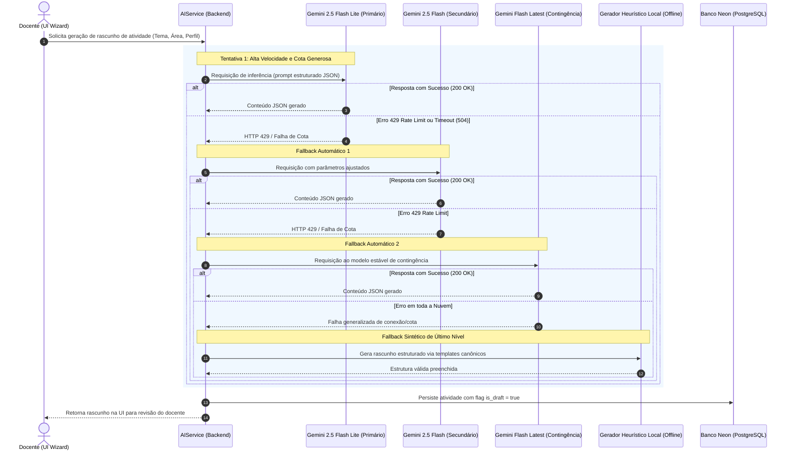

# Arquitetura de Inteligência Artificial: Estratégia Multi-Modelo Gemini com Fallback

Este documento detalha a arquitetura do subsistema de **Inteligência Artificial Generativa** do **Portal GamificaEdu**, responsável por auxiliar os docentes na geração de rascunhos de atividades, diálogos socráticos, histórias imersivas e questões de avaliação, aplicando uma estratégia resiliente de **Multi-Model Fallback** e **Grounding Pedagógico**.

---

## 1. Motivação e Desafios de Engenharia

O processo de criação de uma atividade gamificada completa (composta por múltiplos passos no tabuleiro, textos de introdução, vídeos conceituais e quizzes avaliativos) exige múltiplas chamadas consecutivas a Modelos de Linguagem de Grande Escala (LLMs). 

Em ambientes acadêmicos e testes beta sem orçamento corporativo ilimitado, a utilização de um único modelo na camada gratuita da API frequentemente atinge a taxa máxima de requisições por minuto (**HTTP 429 - Quota Exceeded / Rate Limit**), interrompendo o trabalho do professor no meio da criação.

Para eliminar esse ponto único de falha, concebeu-se uma arquitetura de cascata hierárquica baseada na família **Google Gemini** combinada com **degradação graciosa para sintetizador heurístico local**.

---

## 2. Diagrama de Fluxo e Resiliência da Cascata (Mermaid)

---

## 3. Especificação dos Modelos da Família Gemini

A seleção exclusiva da família Google Gemini (ADR-021) fundamenta-se nas cotas generosas e isoladas oferecidas pelo Google AI Studio:

| Nível na Cascata | Identificador do Modelo | Latência Típica | Cota Gratuita Independente | Papel Arquitetural |
|---|---|---|---|---|
| **Tier 1 (Primário)** | `gemini-2.5-flash-lite` | ~600 ms | 1.500 RPM / Cotas próprias | Velocidade extrema para geração de quizzes de múltipla escolha e resumos rápidos |
| **Tier 2 (Secundário)** | `gemini-2.5-flash` | ~1.100 ms | 1.000 RPM / Cotas próprias | Raciocínio mais refinado para geração de narrativas complexas e diálogos pedagógicos |
| **Tier 3 (Contingência)** | `gemini-flash-latest` | ~1.400 ms | Cotas de legado | Modelo estável acionado caso a versão 2.5 enfrente instabilidades de rollout |
| **Tier 4 (Offline)** | `LocalHeuristicSynthesizer` | < 10 ms | Ilimitada (Local) | Constrói rascunhos baseados em taxonomias pré-cadastradas (`activity_templates.py`) |

---

## 4. Grounding Pedagógico com YouTube Data API

Antes de disparar a geração de roteiros de aula e quizzes pelo LLM, o backend executa um enriquecimento conceitual (*Grounding*):
1. **Consulta Temática:** O backend pesquisa canais educacionais confiáveis no YouTube com base no tópico da aula e na subárea SWEBOK.
2. **Extração de Metadados:** Título, transcrições públicas e descrição do vídeo são injetados no prompt de sistema como contexto de autoridade (*context injection*).
3. **Persistência de Mídia:** A URL do vídeo identificado é automaticamente sugerida para o nó instrucional correspondente (`LearningContent.media_url`).

---

## 5. Governança e Ciclo de Vida: O Estado `isDraft`

Nenhum conteúdo gerado por inteligência artificial é disponibilizado diretamente para os estudantes sem validação humana:
1. **Gravação Segura:** Todo passo gerado pela IA é gravado com a flag booleana `is_draft: true`.
2. **Revisão Obrigatória na Etapa 6/7:** Na tela do Wizard, os nós marcados como rascunho exibem um selo amarelo de revisão pendente.
3. **Transição de Estado:** Quando o professor abre o modal de edição, revisa os enunciados e clica em *"Salvar Alterações"*, o frontend emite `isDraft = false`.
4. **Trava de Publicação:** O sistema impede a publicação da atividade para a turma (Etapa 8) se houver qualquer nó com `is_draft: true`, garantindo integridade pedagógica e respeito às diretrizes éticas de IA na educação.

---

## 6. Referências Cruzadas
- **ADR-021:** Estratégia Multi-Modelo com Google Gemini (`docs/architecture/adrs/ADR-021-multi-model-gemini-fallback.md`)
- **Implementação do Serviço:** `backend/app/services/ai_service.py` e `backend/app/services/ai_prompt_builder.py`
- **Atas de Revisão Técnica da Squad:** `docs/architecture/squad_meetings_ai_pipeline_review.md`
- **Pipeline Detalhado:** `docs/architecture/ai_draft_generation_pipeline.md`
