# Diagrama C4 Nível 3: Arquitetura Hexagonal do Backend (Ports & Adapters)

Este documento detalha a estrutura interna do contêiner de backend do **Portal GamificaEdu**, ilustrando a aplicação estrita do padrão de **Arquitetura Hexagonal (Ports & Adapters)** e os princípios SOLID de Inversão de Dependência (DIP).

---

## 1. Visão Geral da Arquitetura Hexagonal

O núcleo da aplicação (Domínio e Casos de Uso) é estritamente isolado de frameworks web, drivers de banco de dados e APIs externas. A comunicação ocorre exclusivamente através de **Portas** (interfaces abstratas) implementadas por **Adaptadores** concretos.

```mermaid
graph TB
    subgraph InboundAdapters ["Adaptadores de Entrada (Inbound Adapters / Driving)"]
        HTTPAuth["🌐 AuthController<br><i>POST /api/auth/login, register</i>"]
        HTTPActivity["🌐 ActivityController<br><i>GET/POST/DELETE /api/activities</i>"]
        HTTPBoard["🌐 BoardExecutionController<br><i>GET/POST /api/activities/:id/steps</i>"]
        HTTPGamify["🌐 GamificationController<br><i>POST /api/roulette/spin, /api/store/buy</i>"]
        HTTPForum["🌐 ForumController<br><i>GET/POST /api/forum/topics, posts</i>"]
        SocketChat["⚡ SocketChatNamespace<br><i>event: join_room, send_message</i>"]
    end

    subgraph InboundPorts ["Portas de Entrada (Driving Ports / Use Cases)"]
        PortAuth["🔌 IAuthenticateUserUseCase"]
        PortCreateAct["🔌 ICreateActivityUseCase"]
        PortExecuteStep["🔌 IProcessStudentAnswerUseCase"]
        PortRecommend["🔌 IEvaluateContextualRecommendationUseCase"]
        PortSpin["🔌 ISpinRouletteUseCase"]
        PortShop["🔌 IPurchaseStoreItemUseCase"]
        PortForum["🔌 IManageForumDiscussionUseCase"]
    end

    subgraph DomainCore ["Núcleo de Domínio Puro (Domain Core - Zero Frameworks)"]
        subgraph Entities ["Entidades e Regras de Negócio"]
            UserEnt["👤 User & Enrollment"]
            ActEnt["🗺️ Activity & BoardStep"]
            QuizEnt["❓ QuizQuestion & Option"]
            WalletEnt["💰 StudentWallet (XP / Coins)"]
            BadgeEnt["🏅 Badge & AchievementRule"]
            RecVector["📐 ContextVector (SWEBOK, Bloom, Hexad)"]
        end

        subgraph DomainServices ["Serviços de Domínio Especializados"]
            SvcMDC["🧮 <b>ContextualRecommendationService</b><br>Calcula Sinergia Sb, Risco Pc, Moduladores mu/lambda e Veto Pedagógico"]
            SvcReward["🎁 <b>GamificationRewardCalculator</b><br>Regras atômicas de XP vitalício e Moedas gastáveis"]
            SvcPedagogy["🛡️ <b>PedagogicalVetoGuard</b><br>Regra de proteção contra o Dark Side da Gamificação"]
        end
    end

    subgraph OutboundPorts ["Portas de Saída (Driven Ports / Interfaces Secundárias)"]
        PortUserRepo["🔌 IUserRepositoryPort"]
        PortActRepo["🔌 IActivityRepositoryPort"]
        PortGamifyRepo["🔌 IGamificationRepositoryPort"]
        PortForumRepo["🔌 IForumRepositoryPort"]
        PortAIRepo["🔌 IAIEnginePort"]
        PortTelemetry["🔌 ITelemetryEventLoggerPort"]
    end

    subgraph OutboundAdapters ["Adaptadores de Saída (Outbound Adapters / Driven)"]
        RepoSQLUser["🐘 SqlAlchemyUserRepository<br><i>tb_user, tb_enrollment, tb_class</i>"]
        RepoSQLAct["🐘 SqlAlchemyActivityRepository<br><i>tb_activity, tb_quiz_content, tb_narrative</i>"]
        RepoSQLGamify["🐘 SqlAlchemyGamificationRepository<br><i>tb_medal, tb_store_item, tb_roulette_win</i>"]
        RepoSQLForum["🐘 SqlAlchemyForumRepository<br><i>tb_forum_category, tb_topic, tb_post</i>"]
        AdapterGemini["🤖 GoogleGeminiAIAdapter<br><i>Fallback: 2.5-flash-lite -> 2.5-flash -> local</i>"]
        AdapterSocket["⚡ SocketIoEmitterAdapter<br><i>Emissão de eventos em tempo real para salas</i>"]
    end

    %% Conexões de Entrada
    HTTPAuth --> PortAuth
    HTTPActivity --> PortCreateAct
    HTTPActivity --> PortRecommend
    HTTPBoard --> PortExecuteStep
    HTTPGamify --> PortSpin
    HTTPGamify --> PortShop
    HTTPForum --> PortForum
    SocketChat --> PortForum

    %% Conexões dos Use Cases para Domínio
    PortAuth --> UserEnt
    PortCreateAct --> ActEnt
    PortCreateAct --> SvcMDC
    PortExecuteStep --> QuizEnt
    PortExecuteStep --> SvcReward
    PortRecommend --> SvcMDC
    PortRecommend --> SvcPedagogy
    PortSpin --> SvcReward
    PortShop --> WalletEnt

    %% Conexões do Domínio / Use Cases para Portas de Saída
    PortAuth --> PortUserRepo
    PortCreateAct --> PortActRepo
    PortCreateAct --> PortAIRepo
    PortExecuteStep --> PortActRepo
    PortExecuteStep --> PortGamifyRepo
    PortExecuteStep --> PortTelemetry
    PortSpin --> PortGamifyRepo
    PortShop --> PortGamifyRepo
    PortForum --> PortForumRepo
    PortForum --> AdapterSocket

    %% Realização das Portas de Saída pelos Adaptadores Concretos
    PortUserRepo -.-> RepoSQLUser
    PortActRepo -.-> RepoSQLAct
    PortGamifyRepo -.-> RepoSQLGamify
    PortForumRepo -.-> RepoSQLForum
    PortAIRepo -.-> AdapterGemini
    PortTelemetry -.-> RepoSQLUser
```

---

## 2. Especificação das Portas e Contratos de Interface

### 2.1 Inbound Ports (Casos de Uso)

| Interface Inbound | Método Principal | DTO de Entrada | DTO de Saída | Responsabilidade |
|---|---|---|---|---|
| `IAuthenticateUserUseCase` | `execute(credentials)` | `LoginDTO` | `TokenSessionDTO` | Valida credenciais e gera JWT |
| `ICreateActivityUseCase` | `create(payload, teacher_id)` | `CreateActivityDTO` | `ActivitySummaryDTO` | Valida 8 etapas e persiste atividade mestre |
| `IEvaluateContextualRecommendationUseCase` | `recommend(context_vector)` | `DiagnosticContextDTO` | `RecommendationResultDTO` | Executa cálculo algébrico do MUI |
| `IProcessStudentAnswerUseCase` | `submit(step_id, answer_id)` | `AnswerSubmissionDTO` | `EvaluationFeedbackDTO` | Valida resposta, concede XP/moedas e atualiza progresso |
| `ISpinRouletteUseCase` | `spin(student_id)` | `SpinRequestDTO` | `PrizeOutcomeDTO` | Valida data, seleciona prêmio e audita sessão |
| `IPurchaseStoreItemUseCase` | `buy(student_id, item_id)` | `PurchaseDTO` | `ReceiptDTO` | Transação atômica de débito de moedas e entrega de item |

### 2.2 Outbound Ports (Dependências Secundárias)

| Interface Outbound | Implementação Concreta | Tecnologia | Responsabilidade |
|---|---|---|---|
| `IActivityRepositoryPort` | `SqlAlchemyActivityRepository` | SQLAlchemy 2.0 / PostgreSQL | Persistência transacional de atividades, passos e conteúdos |
| `IGamificationRepositoryPort` | `SqlAlchemyGamificationRepository` | SQLAlchemy 2.0 / PostgreSQL | Gestão de saldos, compras ativas, vitórias da roleta e medalhas |
| `IAIEnginePort` | `GoogleGeminiAIAdapter` | Google GenAI SDK | Geração contextual de questões com rotação de cotas |
| `ITelemetryEventLoggerPort` | `SqlAlchemyTelemetryAdapter` | PostgreSQL (JSONB) | Gravação assíncrona de eventos científicos na tabela `EventLog` |

---

## 3. Diretrizes de Inversão de Dependência (DIP)

1. **Independência de Frameworks:** Nenhuma classe em `backend/app/domain/` importa módulos externos como `flask`, `sqlalchemy` ou `requests`. Todas as dependências externas são injetadas no momento da inicialização pelo padrão *Application Factory* (`create_app`).
2. **Entidades com Invariantes Válidas:** A validação de regras de negócio (ex: proibição de saldo de moedas negativo, regras de transição de nós do tabuleiro) reside nos métodos de domínio das próprias entidades, impedindo que entidades transitem em estados inconsistentes.
3. **Mapeamento de Dados:** Adaptadores Inbound convertem requisições HTTP JSON em Value Objects tipados antes de repassar aos Casos de Uso. Adaptadores Outbound convertem Entidades de Domínio em modelos ORM de persistência.

---

## 4. Referências Cruzadas
- **ADR-001:** Application Factory no Flask (`docs/architecture/adrs/ADR-001-application-factory.md`)
- **ADR-003:** Arquitetura de Conteúdo por Passo (`docs/architecture/adrs/ADR-003-step-based-content-architecture.md`)
- **ADR-004:** Separação de XP e Moedas (`docs/architecture/adrs/ADR-004-xp-and-currency-separation.md`)
- **C4 Nível 1 e 2:** Contexto e Contêineres (`docs/architecture/c4_context_container_diagrams.md`)
