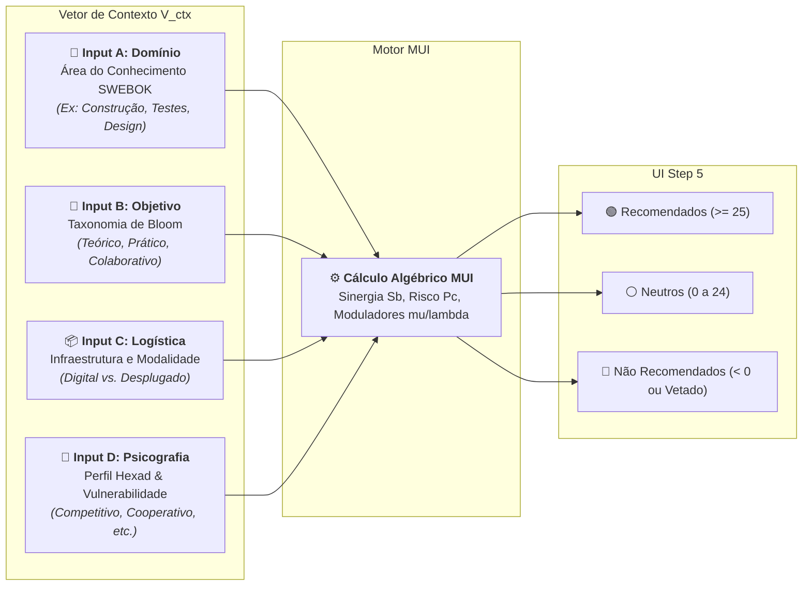
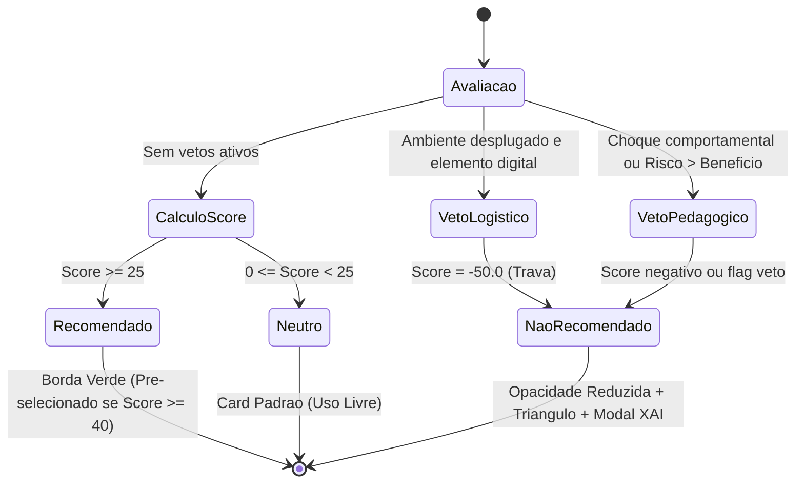

# Motor de Recomendação Contextual (MDC / MUI / SAD)

Este documento descreve a arquitetura matemática, os fundamentos teóricos e a lógica de processamento do **Motor de Recomendação Contextual (MRC)** do Portal GamificaEdu. O motor materializa o **Modelo de Design Contextualizado (MDC)** e opera como um **Sistema de Apoio à Decisão (SAD)** pedagógica baseado em evidências empíricas da literatura (SWEBOK, Bloom, Marczewski Hexad e Teoria da Autodeterminação).

---

## 1. Fundamentação e Problema de Pesquisa

A gamificação educacional frequentemente falha ao adotar abordagens "tamanho único" (*one-size-fits-all*), aplicando mecânicas competitivas (pontos, rankings, placares) indiscriminadamente. Conforme demonstrado por **Toda et al. (2017)** e **Dichev & Dicheva (2017)**, o uso inadequado de mecânicas de comparação social em públicos com alta ansiedade matemática ou turmas fragmentadas ativa o **"Dark Side" da Gamificação**, gerando:
- Ansiedade aguda e desmotivação de alunos de menor rendimento inicial.
- Trapaça (*gaming the system*) e foco míope em recompensas extrínsecas.
- Destruição da cooperação e do clima escolar.

O MRC resolve essa dor transformando a seleção de elementos de jogo em um **processo de design computacional guiado**, que calcula a compatibilidade matemática entre o contexto pedagógico e cada uma das mecânicas disponíveis.

---

## 2. Vetor de Entrada de Contexto ($V_{ctx}$)

No fluxo do assistente de criação de atividades (Wizard de 8 passos), o sistema constrói um vetor multidimensional de diagnóstico $V_{ctx} = (I_A, I_B, I_C, I_D)$:

1. **$I_A$ (Área de Conhecimento):** Mapeado contra o corpus bibliométrico do SWEBOK (`SOFTWARE CONSTRUCTION`, `SOFTWARE DESIGN`, `SOFTWARE TESTING`, `SOFTWARE ENGINEERING PROFESSIONAL PRACTICE`).
2. **$I_B$ (Objetivo Pedagógico):** Extraído semântica e deterministicamente via análise de termos das metas da aula:
   - `teórico`: lógica, abstração, leitura, fundamentação, modelo formal.
   - `prático`: implementação técnica, depuração, testes, execução de código.
   - `colaborativo`: trabalho em equipe, negociação, code review, pair programming.
3. **$I_C$ (Logística e Ambiente):** Flags de infraestrutura. Ex: presença da flag `'desplugado'` (sala física sem dispositivos digitais).
4. **$I_D$ (Perfil da Turma):** Tipologias do modelo Hexad de Andrzej Marczewski (`competitivo`, `social`, `realizador`, `explorador`) combinados com marcadores de vulnerabilidade social.

---

## 3. Modelo Matemático do M.U.I. (Mathematical Utility Inference)

O cálculo de recomendação de cada mecânica de jogo $j$ obedece a um pipeline algébrico em 5 etapas:

### 3.1 Extração da Literatura ($S_b^{puro}$ e $P_c^{puro}$)
A base de evidências científicas (`knowledge_base.json`) fornece os valores brutos fundamentados em revisões sistemáticas da literatura:
- **Sinergia Pura ($S_b^{puro}$):** Benefício pedagógico observado para a área de conhecimento específica.
- **Risco Puro ($P_c^{puro}$):** Risco de efeitos colaterais adversos (ex: ansiedade, dependência).

### 3.2 Moduladores de Contexto ($\mu_{total}$ e $\lambda_{total}$)
Os fatores de contexto modulam o benefício ($\mu$) e o risco ($\lambda$):

$$\mu_{total} = \min(\mu_{perfil}, \mu_{objetivo})$$
$$\lambda_{total} = \max(\lambda_{perfil}, \lambda_{objetivo})$$

A aplicação do princípio **Min-Max** atua como um **gargalo estrito de segurança**: se qualquer um dos fatores contextuais indicar alto atrito comportamental ($\mu = 0.1, \lambda = 5.0$), a condição de risco sobrepõe-se imediatamente a qualquer bônus isolado.

| Combinação Contextual | $\mu$ (Modulador de Benefício) | $\lambda$ (Modulador de Risco) | Efeito Pedagógico |
|---|---|---|---|
| **Afinidade Alta** (ex: Perfil Competitivo com Ranking) | $1.5$ | $0.5$ | Potencializa sinergia e mitiga risco |
| **Neutralidade** (sem correlação explícita) | $1.0$ | $1.0$ | Preserva valores brutos da literatura |
| **Conflito Severo** (ex: Perfil Social com Competição) | $0.1$ | $5.0$ | Colapsa sinergia e quintuplica o risco |

### 3.3 Modulador Ontológico ($\tau$) e Sobrecarga Cognitiva ($\phi$)
- **$\tau$ (Tau Ativo):** Proteção ontológica. Para mecânicas inofensivas de narrativa ou progressão, $\tau = 0.1$. Para mecânicas de comparação social e pressão pública, $\tau = 1.0$.
- **$\phi$ (Phi Ativo):** Modulador da Teoria da Carga Cognitiva de Sweller. Se a disciplina for teoricamente densa e a mecânica demandar esforço estressor agudo (ex: pressão severa de tempo), $\phi = 2.0$; caso contrário, $\phi = 1.0$.

### 3.4 Fronteira de Decisão Algébrica
O score intermediário da mecânica é dado por:

$$S_b^{mod} = S_b^{puro} \times \mu_{total}$$
$$P_c^{mod} = P_c^{puro} \times \tau_{ativo} \times \phi_{ativo} \times \lambda_{total}$$
$$Score_{bruto} = S_b^{mod} - (P_c^{mod} \times \mathbb{I}_{ameaca})$$

Onde a função indicadora de ameaça orgânica $\mathbb{I}_{ameaca}$ suprime o ruído estocástico quando não há evidência empírica real de risco:

$$\mathbb{I}_{ameaca} = \begin{cases} 1, & \text{se } (P_c^{puro} > 0.1) \lor (\lambda_{total} > 1.0) \lor (\phi_{ativo} > 1.0) \\ 0, & \text{caso contrário} \end{cases}$$

### 3.5 Regras de Veto e Normalização Relativa
Uma mecânica é marcada com **Veto Pedagógico** se:
1. **Veto Algébrico:** $(P_c^{mod} > S_b^{mod}) \land (P_c^{mod} > 0.1)$ — o risco mitigado supera o benefício; OU
2. **Veto Heurístico Absoluto:** $(\mu_{total} \le 0.1) \land (\lambda_{total} \ge 5.0)$ — choque comportamental frontal; OU
3. **Veto Logístico:** $I_C = \text{'desplugado'}$ e o elemento requer tecnologia digital (Fórum, Chat, Conquistas Digitais, Economia Monetária).

Para garantir comparabilidade na interface, o score bruto é normalizado no intervalo $[-50, +50]$:

$$Score_{norm} = \left(\frac{Score_{bruto}}{\max(|Score_{pos}|)}\right) \times 50$$

*(Com trava anti-inflação: se $\max(|Score_{pos}|) < 0.2$, adota-se denominador $1.0$). Em caso de Veto Logístico, crava-se $Score_{norm} = -50.0$.*

---

## 4. Agrupamento em Clusters na Interface (UX Step 5)

A interface reativa do Wizard particiona os 28 elementos de jogo em 3 clusters distintos:

1. **Recomendados ($Score_{norm} \ge 25$):**
   - Apresentam borda verde e selo de alta compatibilidade pedagógica.
   - Pré-selecionados se $Score_{norm} \ge 40$.
   - Justificativa de explicabilidade (XAI) destacando o perfil impulsionador (ex: *"Alta Afinidade: Potencializado pelo Perfil Competitivo e Objetivo Prático"*).
2. **Neutros ($0 \le Score_{norm} < 25$):**
   - Apresentação padrão. O professor possui total liberdade para marcar ou desmarcar.
3. **Não Recomendados / Vetados ($Score_{norm} < 0$ ou flag Veto):**
   - Opacidade reduzida e triângulo amarelo/vermelho de atenção pedagógica.
   - Se o professor clicar no elemento, o sistema **não proíbe** (preserva a autonomia do docente), mas abre um **Modal de Conflito Pedagógico (Soft Block)** com explicabilidade forense:
     > *"Atenção: A mecânica 'Sistema de classificação e ranking' foi vetada devido a choque severo com o Perfil Cooperativo e Objetivo Colaborativo da turma. O uso de rankings competitivos pode inibir estudantes com ansiedade. Deseja manter mesmo assim?"*

---

## 5. Referências Cruzadas
- **Implementação do Serviço:** `backend/app/services/recommendation_engine.py`
- **ADR-011:** Padrão Container/Presentational no Wizard (`docs/architecture/adrs/ADR-011-container-presentational-wizard.md`)
- **Dedução Matemática:** `docs/academic/mathematical_model_mui.md`
- **Histórico de Decisão:** `docs/archive/repositorio_doutorado/Relatório de Especificação Funcional.docx`
