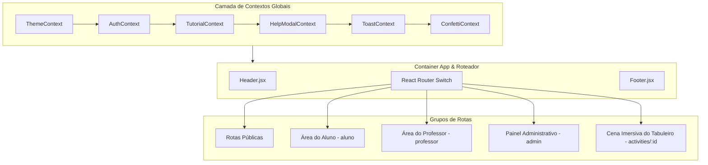

# Arquitetura do Frontend — Portal GamificaEdu

> **Status:** Ativo & Atualizado  
> **Escopo:** Frontend React (Vite 7, React Router, TailwindCSS, Socket.IO, Framer Motion)  
> **Cobertura da Interface:** >= 90% dos fluxos e componentes documentados  

---

## 1. Visão Geral da Arquitetura do Frontend

O frontend do **Portal GamificaEdu** é uma Single Page Application (SPA) construída com **React**, empacotada via **Vite** e estilizada com **TailwindCSS** e **CSS Custom Properties** (para alternância de temas Claro/Escuro).

A aplicação opera em modo de responsividade completa (Mobile-First adaptativo), com controle estrito de RBAC (*Role-Based Access Control*) no cliente, integração síncrona via **Socket.IO** (para Chat e pipeline de geração com IA) e comunicação REST via **Axios** com interceptores para injeção de tokens JWT.

---

## 2. Árvore de Contextos e Gerenciamento de Estado

O frontend não utiliza bibliotecas pesadas de estado global (como Redux), optando por **React Context API** fatiada por domínios de responsabilidade única:

| Contexto | Arquivo | Responsabilidade |
| :--- | :--- | :--- |
| **`ThemeContext`** | `frontend/src/context/ThemeContext.jsx` | Controla alternância entre tema claro (`light`) e escuro (`dark`). Persiste preferência no `localStorage` e aplica classes no elemento `<html>`. |
| **`AuthContext`** | `frontend/src/context/AuthContext.jsx` | Gerencia estado de autenticação (`user`, `token`, `role`), login com credenciais locais, Google OAuth, logout e limpeza de tokens. |
| **`TutorialContext`** | `frontend/src/context/TutorialContext.jsx` | Orquestra tours interativos com `react-joyride`. Rastreia conclusão de onboarding via backend (`/api/auth/user/update-onboarding`). |
| **`HelpModalContext`** | `frontend/src/context/HelpModalContext.jsx` | Controla a exibição de modais de ajuda e FAQ contextuais acionados pelo usuário. |
| **`ToastContext`** | `frontend/src/context/ToastContext.jsx` | Gerenciador de notificações toast efêmeras (sucesso, erro, alerta, info). |
| **`ConfettiContext`** | `frontend/src/context/ConfettiContext.jsx` | Dispara efeitos de partículas e celebração em conclusões de atividades e conquistas de medalhas. |
| **`ActivityContext`** | `frontend/src/context/ActivityContext.jsx` | Alimenta a cena de execução da atividade no tabuleiro (`ActivityPage`), contendo dados da atividade, progresso do aluno, inventário de moedas e telemetria de respostas. |
| **`ActivityCreationContext`** | `frontend/src/context/ActivityCreationContext.jsx` | Mantém o rascunho de criação/edição da atividade ao longo das 8 etapas do wizard, incluindo rascunhos gerados por IA e salvamento automático (`useAutoSave`). |

---

## 3. Matriz Completa de Telas e Interfaces (Rotas)

A aplicação conta com **39 páginas (.jsx)** e **62 componentes**, cobrindo 100% dos casos de uso de alunos, professores, administradores e visitantes:

### 3.1. Telas Públicas e Institucionais
| Rota | Componente de Página | Descrição Funcional |
| :--- | :--- | :--- |
| `/` | `HomePage.jsx` | Landing page com proposta de valor, estatísticas públicas consumidas da API `/api/public/stats`, depoimentos e chamada para ação (CTA). |
| `/login` | `LoginPage.jsx` | Formulário de autenticação de usuários com e-mail/senha e botão de login social via Google OAuth. Link para recuperação de senha. |
| `/cadastro` | `RegisterPage.jsx` | Formulário de registro. Permite criar conta como `aluno` ou `professor` (este exige código de acesso institucional). |
| `/recuperar-senha` | `ForgotPasswordPage.jsx` | Solicitação de link de redefinição de senha com envio assíncrono de e-mail. |
| `/reset-password/:token` | `ResetPasswordPage.jsx` | Validação do token temporal e criação da nova senha. |
| `/sobre-nos` | `AboutUsPage.jsx` | Página institucional com foto e biografia da equipe de pesquisa e desenvolvimento (Prof. Armando Toda e Júlio Budiski). |
| `/contact` | `ContactPage.jsx` | Canal de contato e envio de mensagens para o suporte do portal. |
| `/404` & `*` | `NotFoundPage.jsx` | Página de erro amigável com opção de retorno à Home e modo de recuperação de crash de runtime. |

### 3.2. Telas da Área do Aluno (`role === 'aluno'`)
| Rota | Componente de Página | Descrição Funcional |
| :--- | :--- | :--- |
| `/aluno/dashboard` | `StudentDashboardPage.jsx` | Painel principal do aluno com resumo de XP acumulado, saldo de moedas, atalhos de turmas matriculadas, medalhas recentes e indicador de nível. |
| `/aluno/entrar-turma` | `JoinClassPage.jsx` | Interface para inserção do código de inscrição alfanumérico fornecido pelo professor para auto-matrícula em turmas. |
| `/aluno/minhas-atividades` | `StudentActivityPage.jsx` | Grade com todas as atividades atribuídas ao aluno, segmentadas por status (Não iniciadas, Em andamento, Concluídas). |
| `/aluno/desempenho` | `StudentPerformancePage.jsx` | Visão de desempenho individual com histórico de pontuações, precisão de respostas e ranking. |
| `/activities/:activityId` | `ActivityPage.jsx` | **Cena Imersiva do Tabuleiro de Jogo:** Interface principal de gamificação onde o aluno navega visualmente pelas etapas da atividade. |

### 3.3. Telas da Área do Professor (`role === 'professor'`)
| Rota | Componente de Página | Descrição Funcional |
| :--- | :--- | :--- |
| `/professor/dashboard` | `TeacherDashboardPage.jsx` | Painel do professor com métricas resumidas, turmas ativas, atividades recentes e ações rápidas. |
| `/professor/criar-atividade` | `ActivityCreationPage.jsx` | **Wizard de Criação em 8 Etapas:** Ferramenta central de game design pedagógico com apoio do Motor de Recomendação Contextual (MDC) e IA. |
| `/professor/criar-atividade/:activityId` | `ActivityCreationPage.jsx` | Retomada de rascunho de atividade em elaboração. |
| `/professor/atividades/:activityId/edit` | `ActivityEditPage.jsx` | Edição estrutural de atividades existentes. |
| `/professor/banco-atividades` | `ActivityBankPage.jsx` | Catálogo e repositório de atividades da plataforma (públicas e próprias), permitindo clonagem e reatribuição. |
| `/professor/gerenciar-turmas` | `ClassManagementPage.jsx` | Listagem de turmas criadas, geração e cópia do código de matrícula e remoção de turmas. |
| `/professor/turmas/nova` | `CreateClassPage.jsx` | Formulário para criação de nova turma. |
| `/classes/:class_id` | `ClassDetailsPage.jsx` | Detalhes da turma: lista de alunos matriculados, atividades atribuídas e progresso coletivo. |
| `/classes/:class_id/edit` | `ClassEditPage.jsx` | Edição de nome e descrição de turma existente. |
| `/assign-activity-to-class/:activityId` | `AssignActivityToClass.jsx` | Interface para vincular uma atividade a uma ou mais turmas com definição de prazo e agendamento. |
| `/professor/desempenho-alunos` | `StudentPerformancePage.jsx` | Painel analítico de notas, acurácia e progresso dos alunos por turma e atividade. |
| `/professor/ranking` | `TeacherRankingPage.jsx` | Ranking comparativo entre turmas ou estudantes da disciplina. |
| `/professor/atividades/:id/quiz/:stepId/edit` | `QuizEditorPage.jsx` | Editor especializado de questões de múltipla escolha para o passo. |
| `/professor/atividades/:id/narrative/:stepId/edit` | `NarrativeEditorPage.jsx` | Editor de roteiro de diálogos entre personagens e escolha de cenários visuais. |
| `/professor/atividades/:id/learning-material/:stepId/edit` | `LearningContentEditorPage.jsx` | Editor de texto rico em Markdown para fundamentação teórica do passo. |

### 3.4. Telas do Painel Administrativo (`role === 'admin'`)
| Rota | Componente de Página | Descrição Funcional |
| :--- | :--- | :--- |
| `/admin` | `DashboardOverviewPage.jsx` | Visão geral do ecossistema: total de usuários, turmas, atividades, registros de telemetria e gráficos analíticos. |
| `/admin/users` | `UserManagementPage.jsx` | Gestão de contas de usuários (ativação, suspensão, alteração de perfis e pesquisa). |
| `/admin/activities` | `ActivityManagementPage.jsx` | Moderação global do catálogo de atividades e auditoria de conteúdo. |
| `/admin/analytics` | `SystemAnalyticsPage.jsx` | Métricas de uso da plataforma, retenção e taxas de conversão. |
| `/admin/logs` | `LogExplorerPage.jsx` | Inspetor de eventos de segurança e auditoria (`EventLog`), com filtro por data e exportação em CSV higienizado. |
| `/admin/mapa-localizacao` | `LocationMapPage.jsx` | Visualização geográfica dos acessos através de mapa interativo (Leaflet). |
| `/admin/messages` | `ContactMessagesPage.jsx` | Caixa de entrada de mensagens submetidas via formulário de contato. |

---

## 4. Detalhamento dos Componentes Centrais de Gamificação e Interface

### 4.1. Cena Imersiva de Atividade (`ActivityPage.jsx`)
A interface imersiva isola o aluno da navegação padrão da aplicação (ocultando cabeçalho padrão e rodapé). Ela é composta por:
- **`GameBoardViewer.jsx`**: Renderizador interativo do tabuleiro em formato de trilha (suporta temas *Vila da Aventura*, *Flowchart*, *Space*, etc.), onde cada nó representa um passo pedagógico (`narrative`, `quiz`, `content`).
- **`GameHUD.jsx`**: Barra superior estilo jogo contendo avatar do jogador, barra de nível, pontos de XP acumulados, saldo de moedas em tempo real e botão de saída/pausa.
- **`InteractionPanel.jsx` / `ActivityViewOverlay.jsx`**: Janela modal de interação que se abre ao clicar no nó ativo do tabuleiro, apresentando a narrativa, o desafio de quiz ou o material de leitura.
- **Mecânicas Auxiliares:**
  - **`RouletteTab.jsx` & `CustomWheel.jsx`**: Roleta diária de recompensas (cooldown server-side).
  - **`StoreTab.jsx`**: Loja de cosméticos para aquisição de novos avatares e temas.
  - **`LeaderboardTab.jsx`**: Placar de líderes da turma em tempo real.
  - **`ChatTab.jsx`**: Bate-papo da turma síncrono via WebSockets.
  - **`ForumTab.jsx`**: Fórum assíncrono para dúvidas categorizadas por passo.

### 4.2. Wizard de Criação de Atividades em 8 Etapas (`ActivityCreationStepper.jsx`)
O wizard do professor orienta o design pedagógico e estrutural:
1. **`Step1_Activity.jsx` (Informações Básicas):** Título, disciplina, público-alvo e descrição geral.
2. **`Step2_Activity.jsx` (Diagnóstico Pedagógico):** Cenário atual, objetivos de aprendizagem e competências SWEBOK.
3. **`Step3_Activity.jsx` (Perfil do Jogador & Hexad):** Definição da persona discente predominante (Achiever, Philanthropist, Socialiser, Free Spirit, Player, Disruptor).
4. **`Step4_Activity.jsx` (Seleção de Mecânicas & MDC):** Painel do Motor de Recomendação Contextual que previne combinações nocivas.
5. **`Step5_Activity.jsx` (Estruturação da Trilha de Passos):** Definição da sequência de passos no tabuleiro (Narrativas, Quizzes, Textos de Apoio).
6. **`Step6_Activity.jsx` (Geração e Orquestração por IA):** Integração com `aiService.js` para geração de rascunhos de diálogos e perguntas usando Google Gemini.
7. **`Step7_Activity.jsx` (Economia & Regras de Recompensa):** Calibração de XP e moedas concedidos por passo e acerto.
8. **`Step8_Activity.jsx` (Revisão e Publicação):** Prévia interativa, teste do tabuleiro e publicação/atribuição.

---

## 5. Serviços de Comunicação e Camada de Rede

- **`frontend/src/services/api.js`**: Cliente Axios configurado com `baseURL = /api` e interceptor de requisição que adiciona automaticamente o cabeçalho `Authorization: Bearer <token>`. Interceptores de resposta tratam erros 401 efetuando logout automático e redirecionando para a tela de autenticação.
- **`frontend/src/services/activityService.js`**: Abstração de chamadas para CRUD de atividades, publicação de rascunhos e comunicação com o pipeline de orquestração de IA via streaming e WebSockets.
