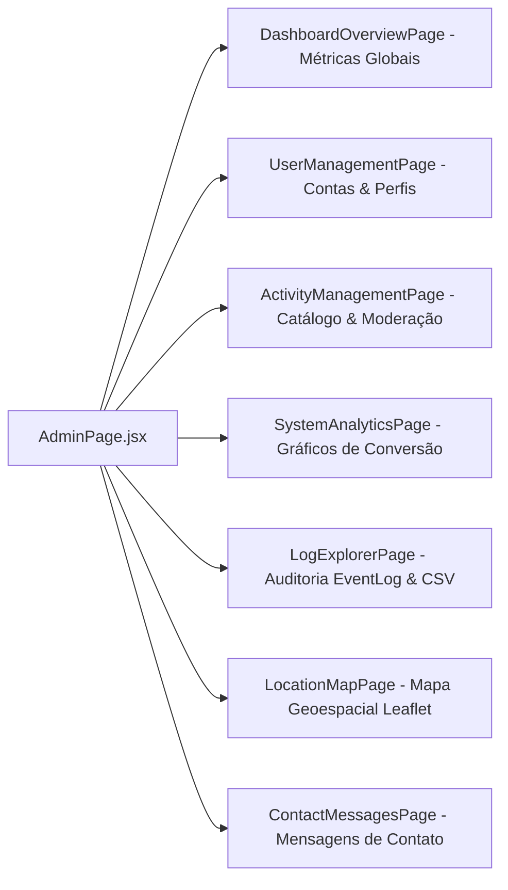

# Console Administrativo e Telemetria Científica

> **Status:** Ativo & Atualizado  
> **Escopo:** Gestão de Usuários, Moderação de Atividades, Analytics do Sistema, Auditoria de Segurança e Mapa de Conexões  
> **Acesso Exclusivo:** Usuários com perfil `role === 'admin'` (`/admin/*`)  

---

## 1. Visão Geral da Área Administrativa (`AdminPage.jsx`)

- **Rota Raiz:** `/admin`
- **Acesso:** Privado (`allowedRoles={['admin']}`)
- **Estrutura:** Layout em duas colunas, com barra lateral persistente de navegação administrativa e área principal renderizando as sub-rotas através de `<Outlet />`.

---

## 2. Sub-Telas do Console Administrativo

### 2.1 Visão Geral do Sistema (`DashboardOverviewPage.jsx`)
- **Rota:** `/admin` (Index)
- **Métricas Apresentadas:**
  - Total de usuários registrados na plataforma (segmentados por alunos, professores e administradores).
  - Total de turmas em andamento e atividades criadas.
  - Total de eventos de telemetria coletados no banco de dados.
  - Indicadores de atividade recente e novos cadastros da semana.

### 2.2 Gerenciamento de Usuários (`UserManagementPage.jsx`)
- **Rota:** `/admin/users`
- **Operações Disponíveis:**
  - Pesquisa por nome ou e-mail com paginação server-side.
  - Alteração de papéis (promover a professor, rebaixar ou tornar administrador).
  - Bloqueio e reativação de contas (`status = 'ACTIVE'` ou `status = 'SUSPENDED'`).
  - Emissão de códigos de acesso institucionais para professores específicos.

### 2.3 Moderação de Atividades (`ActivityManagementPage.jsx`)
- **Rota:** `/admin/activities`
- **Operações Disponíveis:**
  - Visualização de todas as atividades públicas e privadas da plataforma.
  - Auditoria de conteúdo (checagem contra profanidades e diretrizes pedagógicas).
  - Exclusão ou desativação de atividades impróprias.

### 2.4 Análise do Sistema (`SystemAnalyticsPage.jsx`)
- **Rota:** `/admin/analytics`
- **Métricas e Gráficos:**
  - Taxas de retenção de alunos por atividade.
  - Tempo médio despendido em passos de leitura vs quizzes.
  - Eficácia do motor de recomendação (quais mecânicas recomendadas têm maior adesão).

### 2.5 Explorador de Logs e Auditoria de Segurança (`LogExplorerPage.jsx`)
- **Rota:** `/admin/logs`
- **Funcionalidades de Auditoria:**
  - Tabela filtrável de eventos de auditoria registrados na tabela `event_log`.
  - Filtros por intervalo de datas, seção do sistema, ação (ex: login, criação de atividade, erro WAF) e usuário.
  - **Exportação CSV Higienizada (VULN-22):** Botão de download de logs em planilha, aplicando prefixação com apóstrofo em células de fórmulas para proteção contra CSV/Formula Injection.

### 2.6 Mapa Geoespacial de Conexões (`LocationMapPage.jsx`)
- **Rota:** `/admin/mapa-localizacao`
- **Tecnologia:** Leaflet e React-Leaflet.
- **Funcionamento:** Renderiza no mapa mundi/Brasil as coordenadas aproximadas de acesso autorizadas pelos usuários via consentimento prévio, permitindo à pesquisa de Doutorado verificar a distribuição geográfica de adoção do portal.

### 2.7 Mensagens de Contato (`ContactMessagesPage.jsx`)
- **Rota:** `/admin/messages`
- **Funcionamento:** Caixa de entrada de feedbacks, sugestões e pedidos de suporte submetidos através do formulário público `/contact`. Permite marcar mensagens como lidas ou respondidas.
