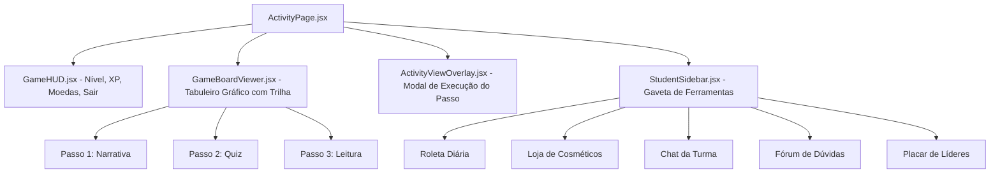

# Área do Aluno e Experiência Gamificada

> **Status:** Ativo & Atualizado  
> **Escopo:** Dashboard do Estudante, Gestão de Atividades, Matrícula e Cena Imersiva do Tabuleiro  
> **Acesso Exclusivo:** Usuários com perfil `role === 'aluno'`  

---

## 1. Dashboard Principal do Aluno (`StudentDashboardPage.jsx`)

- **Rota:** `/aluno/dashboard`
- **Acesso:** Privado (`allowedRoles={['aluno']}`)
- **Objetivo:** Fornecer ao estudante um ponto central de comando e progresso na sua jornada de aprendizagem.
- **Painéis e Métricas em Tempo Real:**
  - **Status do Jogador:** Exibe o avatar equipado, nome, nível atual do aluno e barra de progresso visual de XP.
  - **Saldo da Economia:** Apresenta o saldo acumulado de **Moedas de Ouro** (para compras na loja) separado do **XP Vitalício** (usado para nível e placares de líderes, conforme ADR-004).
  - **Turmas Matriculadas:** Cards interativos listando as turmas em que o aluno está inscrito, professor responsável e link direto para os detalhes da turma.
  - **Atividades Pendentes:** Alerta de atividades com prazo próximo de expiração.
  - **Medalhas Recentes:** Exibição das últimas insígnias desbloqueadas pelo estudante.
  - **Tour Interativo de Boas-Vindas:** Integrado via `react-joyride` com as etapas definidas em [`tutorialSteps.js`](../../frontend/src/data/tutorialSteps.js) (`STUDENT_DASHBOARD_STEPS`).

---

## 2. Inscrição em Turmas (`JoinClassPage.jsx`)

- **Rota:** `/aluno/entrar-turma`
- **Acesso:** Privado (`aluno`)
- **Objetivo:** Permitir ao aluno entrar em uma turma fornecida pelo professor através de um código de matrícula único.
- **Fluxo Operacional:**
  - O aluno digita ou cola o código (ex: `MAT-2026-X9`).
  - O formulário valida o formato e envia POST para `/api/classes/join`.
  - Em caso de sucesso (HTTP 201), uma notificação toast de boas-vindas é exibida e o aluno é direcionado para a lista de atividades.
  - Tratamento de erro 409 caso o aluno já esteja matriculado ou 404 caso o código seja inválido.

---

## 3. Minhas Atividades (`StudentActivityPage.jsx`)

- **Rota:** `/aluno/minhas-atividades`
- **Acesso:** Privado (`aluno`)
- **Objetivo:** Listar e filtrar todas as missões atribuídas ao estudante.
- **Funcionalidades de Interface:**
  - **Abas de Filtragem:**
    - *Não Iniciadas:* Atividades disponíveis que ainda não tiveram o primeiro nó acessado.
    - *Em Andamento:* Atividades com progresso parcial registrado em `activity_progress`.
    - *Concluídas:* Atividades finalizadas com medalhas e moedas já computadas.
  - **Cards de Atividade ([`ActivityCard.jsx`](../../frontend/src/components/activity/ActivityCard.jsx)):**
    - Exibe tema visual, título da atividade, matéria, prazo limite e barra percentual de conclusão.
    - Botão de ação: "Iniciar Jornada" ou "Continuar Missão", direcionando para `/activities/:activityId`.

---

## 4. Desempenho e Histórico do Estudante (`StudentPerformancePage.jsx`)

- **Rota:** `/aluno/desempenho`
- **Acesso:** Privado (`aluno`)
- **Objetivo:** Oferecer transparência e autoavaliação formativa para o aluno.
- **Métricas Apresentadas:**
  - Quantidade total de atividades realizadas.
  - Média de acurácia em quizzes (respostas certas na primeira tentativa).
  - Histórico de moedas ganhas e investidas na loja de recompensas.
  - Posição relativa nos rankings de turmas em que está inserido.

---

## 5. Cena Imersiva de Jogo: O Tabuleiro Interativo (`ActivityPage.jsx`)

- **Rota:** `/activities/:activityId`
- **Acesso:** Privado (Alunos matriculados na turma vinculada)
- **Modo de Exibição:** Imersivo (Fullscreen / App Shell simplificado, ocultando rodapé e cabeçalho padrão).

### 5.1 Game HUD Superior ([`GameHUD.jsx`](../../frontend/src/components/activity/GameHUD.jsx))
- Mostra o avatar personalizado do aluno.
- Saldo dinâmico de moedas e barra de XP que anima em tempo real ao concluir nós.
- Indicador de conectividade WebSockets para o chat da atividade.
- Botão "Pausar / Voltar para o Dashboard".

### 5.2 O Tabuleiro de Trilha ([`GameBoardViewer.jsx`](../../frontend/src/components/activity/GameBoardViewer.jsx))
- Renderiza graficamente a jornada pedagógica em nós sequenciais interligados por caminhos.
- **Temas Visuais Suportados:**
  - *Vila da Aventura* (estilo RPG medieval fantástico).
  - *Flowchart* (estilo arquitetura e diagramas de software).
  - *Cyber / Space* (ficção científica e computação avançada).
- **Estados dos Nós:**
  - *Bloqueado (Cadeado):* Nós futuros que exigem a conclusão do nó anterior.
  - *Disponível (Pulsante):* O nó atual em que o aluno deve interagir.
  - *Concluído (Check Verde/Dourado):* Nós já finalizados com sucesso (permite revisitar sem penalidades).

### 5.3 Overlay de Interação com Conteúdo ([`ActivityViewOverlay.jsx`](../../frontend/src/components/activity/ActivityViewOverlay.jsx))
Abre-se ao clicar no nó ativo:
- **`NarrativeTab.jsx`:** Apresenta diálogos entre mentor e aprendiz com balões de fala, avatares expressivos e escolhas contextuais.
- **`QuizTab.jsx`:** Questões de múltipla escolha com feedback explicativo imediato e cálculo de moedas baseado em acertos na primeira tentativa (ADR-019).
- **`LearningMaterialViewer.jsx`:** Documento de fundamentação técnica renderizado com formatação rica em Markdown e blocos de código syntax-highlighted.

### 5.4 Ferramentas Sociais e de Gamificação na Barra Lateral
- **Roleta da Sorte ([`RouletteTab.jsx`](../../frontend/src/components/activity/RouletteTab.jsx) & [`CustomWheel.jsx`](../../frontend/src/components/activity/CustomWheel.jsx)):** Permite 1 giro diário para concorrer a moedas extras, títulos ou avatares raros.
- **Loja de Itens ([`StoreTab.jsx`](../../frontend/src/components/activity/StoreTab.jsx)):** O aluno pode gastar suas moedas para adquirir novos temas e itens cosméticos.
- **Chat em Tempo Real ([`ChatTab.jsx`](../../frontend/src/components/activity/ChatTab.jsx)):** Canal de texto síncrono com colegas da turma via Socket.IO.
- **Fórum de Dúvidas ([`ForumTab.jsx`](../../frontend/src/components/activity/ForumTab.jsx)):** Espaço assíncrono para perguntas estruturadas vinculadas à atividade.
