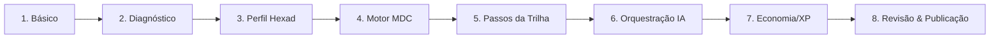

# Área do Professor: Autoria, Gestão e Avaliação

> **Status:** Ativo & Atualizado  
> **Escopo:** Wizard de Criação em 8 Etapas, Motor de Recomendação Contextual (MDC), Editores de Conteúdo e Gestão de Turmas  
> **Acesso Exclusivo:** Usuários com perfil `role === 'professor'`  

---

## 1. Dashboard do Professor (`TeacherDashboardPage.jsx`)

- **Rota:** `/professor/dashboard`
- **Acesso:** Privado (`allowedRoles={['professor']}`)
- **Visão Geral:** Hub central de operações do educador, contendo:
  - **Ações Rápidas:** Botões em destaque para "Criar Nova Atividade" e "Nova Turma".
  - **Resumo de Turmas:** Listagem de turmas ativas com contagem de matriculados e código de matrícula visível para cópia rápida.
  - **Banco de Atividades Recentes:** Rascunhos em progresso e atividades já publicadas.
  - **Tour Guiado:** Tutorial interativo acionado pelo menu superior (`handleTeacherTour`).

---

## 2. Wizard de Criação de Atividades em 8 Etapas (`ActivityCreationPage.jsx`)

- **Rotas:** `/professor/criar-atividade` e `/professor/criar-atividade/:activityId`
- **Contexto:** Envolvido por [`ActivityCreationProvider`](../../frontend/src/context/ActivityCreationContext.jsx).
- **Recurso de Auto-Save:** Integra o hook [`useAutoSave.js`](../../frontend/src/hooks/useAutoSave.js) para evitar perda de dados em rascunhos.

### Detalhamento das Etapas do Stepper:
1. **Passo 1 — Informações Básicas ([`Step1_Activity.jsx`](../../frontend/src/components/activity/creation_steps/Step1_Activity.jsx)):**
   - Título da atividade, descrição, área de conhecimento e escolha do tema gráfico do tabuleiro (*Vila da Aventura*, *Flowchart*, *Space*).
2. **Passo 2 — Diagnóstico Pedagógico ([`Step2_Activity.jsx`](../../frontend/src/components/activity/creation_steps/Step2_Activity.jsx)):**
   - Cenário atual dos alunos, objetivos de aprendizagem pretendidos e competências do SWEBOK a serem trabalhadas.
3. **Passo 3 — Perfil do Jogador & Hexad ([`Step3_Activity.jsx`](../../frontend/src/components/activity/creation_steps/Step3_Activity.jsx)):**
   - Definição da distribuição de tipos de jogadores (Achiever, Philanthropist, Socialiser, Free Spirit, Player, Disruptor).
4. **Passo 4 — Seleção de Mecânicas e Motor de Recomendação Contextual ([`Step4_Activity.jsx`](../../frontend/src/components/activity/creation_steps/Step4_Activity.jsx)):**
   - Sistema de Apoio à Decisão (SAD) que calcula a sinergia entre os objetivos e os perfis Hexad selecionados.
   - Clusterização visual dos elementos de jogos: *Recomendados*, *Neutros* e *Não Recomendados* (com alertas de risco de Dark Side da gamificação).
5. **Passo 5 — Estruturação da Trilha de Passos ([`Step5_Activity.jsx`](../../frontend/src/components/activity/creation_steps/Step5_Activity.jsx)):**
   - Montagem linear dos nós do tabuleiro. Permite adicionar, remover e reordenar passos dos tipos:
     - `narrative`: Diálogos imersivos entre personagens.
     - `quiz`: Desafio avaliativo com perguntas de múltipla escolha.
     - `content`: Fundamentação teórica em Markdown.
6. **Passo 6 — Geração e Orquestração com Inteligência Artificial ([`Step6_Activity.jsx`](../../frontend/src/components/activity/creation_steps/Step6_Activity.jsx)):**
   - Disparo do pipeline de IA generativa (Google Gemini) via [`activityService.js`](../../frontend/src/services/activityService.js) e WebSockets.
   - Geração automática de roteiros de diálogos para as narrativas e perguntas com gabarito comentado para os quizzes.
7. **Passo 7 — Economia e Regras de Gamificação ([`Step7_Activity.jsx`](../../frontend/src/components/activity/creation_steps/Step7_Activity.jsx)):**
   - Configuração de pontuação de XP vitalício concedido ao completar o tabuleiro e distribuição de moedas por acerto em quizzes.
8. **Passo 8 — Prévia e Publicação ([`Step8_Activity.jsx`](../../frontend/src/components/activity/creation_steps/Step8_Activity.jsx)):**
   - Validação final do rascunho, teste do tabuleiro em modo sandbox e publicação oficial no catálogo.

---

## 3. Editores Específicos de Passos Pedagógicos

Quando o professor clica para editar o conteúdo interno de um nó do tabuleiro, a aplicação carrega telas especializadas:

### 3.1 Editor de Quizzes (`QuizEditorPage.jsx`)
- **Rota:** `/professor/atividades/:activityId/quiz/:stepId/edit`
- **Funcionalidades:**
  - Criação de enunciados de perguntas.
  - Cadastro de até 5 alternativas de resposta por questão com marcação da alternativa correta.
  - Inserção de feedback pedagógico explicativo para cada alternativa (justificando por que está certa ou qual o erro comum na alternativa errada).
  - Configuração do limite de tentativas e pontuação máxima.

### 3.2 Editor de Narrativa e Roteiro (`NarrativeEditorPage.jsx`)
- **Rota:** `/professor/atividades/:activityId/narrative/:stepId/edit`
- **Funcionalidades:**
  - Escolha do cenário de fundo da história (arte conceitual em pixel art ou ilustrada).
  - Definição do elenco (Instrutor/Mentor vs Aluno/Estagiário).
  - Linha do tempo de falas com indicação de expressão facial do avatar e texto de diálogo.

### 3.3 Editor de Conteúdo e Material Didático (`LearningContentEditorPage.jsx`)
- **Rota:** `/professor/atividades/:activityId/learning-material/:stepId/edit`
- **Funcionalidades:**
  - Editor em Markdown com visualização simultânea (*split-screen preview*).
  - Suporte a formatação com negrito, listas, blockquotes e blocos de código com destaque de sintaxe para linguagens de programação.

---

## 4. Gestão de Turmas e Atribuição de Atividades

### 4.1 Gerenciamento de Turmas (`ClassManagementPage.jsx` & `CreateClassPage.jsx`)
- **Rotas:** `/professor/gerenciar-turmas` e `/professor/turmas/nova`
- Criação e manutenção de turmas da instituição.
- Cada turma possui um `enrollment_code` exclusivo e um botão de cópia com um clique para compartilhamento com alunos.

### 4.2 Detalhes da Turma e Alunos (`ClassDetailsPage.jsx`)
- **Rota:** `/classes/:class_id`
- Lista todos os estudantes inscritos na turma, com status de atividade e data de matrícula.
- Permite remover matrículas de alunos indevidos e visualizar o progresso conjunto da classe.

### 4.3 Atribuição de Atividades a Turmas (`AssignActivityToClass.jsx`)
- **Rota:** `/assign-activity-to-class/:activityId`
- Permite associar uma atividade do banco de atividades a uma ou mais turmas.
- Definição de agendamento:
  - Data e hora de abertura (`available_from`).
  - Prazo final de entrega (`expires_at`), com bloqueio automático pós-prazo (ADR-018).

---

## 5. Acompanhamento de Desempenho e Avaliação (`StudentPerformancePage.jsx`)

- **Rota:** `/professor/desempenho-alunos`
- **Segurança (VULN-12):** Protegido contra BOLA/IDOR; o professor só consegue consultar turmas sob sua própria autoria.
- **Relatórios Gerados:**
  - Tabela consolidada com nome do aluno, e-mail, status da atividade, pontuação obtida, acurácia e total de tentativas em quizzes.
  - Filtros por turma, atividade e busca textual por estudante.
  - Indicadores globais da turma: média de pontuação, taxa de conclusão e aproveitamento geral.
