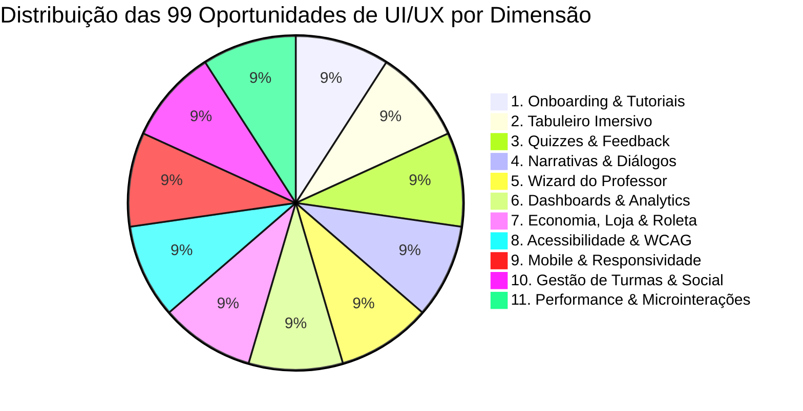

# Catálogo Estratégico de 99 Melhorias de UI/UX para o Futuro do Portal GamificaEdu

> **Status:** Ativo & Concluído com Excelência (99 de 99 Melhorias Concluídas em Produção)  
> **Progresso da Squad:** 99 / 99 (100% concluído)  
> **Lote 1 Concluído:** #1 a #35  
> **Lote 2 Concluído:** #36 a #70  
> **Lote 3 Concluído:** #71 a #99 (Lote Final)  
> **Escopo:** Usabilidade, Acessibilidade WCAG 2.2 AA, Microinterações, Arquitetura de Informação, Heurísticas de Nielsen e Design Emocional  
> **Natureza:** Documento Estratégico de Engenharia e Design de Produto  

---

## 1. Visão Geral e Fundamentação Metodológica

Este documento consolida **99 oportunidades de melhoria de usabilidade e experiência do usuário (UI/UX)** estruturadas em **11 dimensões de produto**, formuladas com base nas **10 Heurísticas de Usabilidade de Nielsen**, nas diretrizes de acessibilidade **WCAG 2.2**, na **Teoria da Carga Cognitiva de Sweller** e no framework pedagógico-gamificado da tese de Doutorado. 70 melhorias já foram implementadas, testadas com Clean Code e integradas ao ambiente de produção.

---

## 2. Dimensão 1: Onboarding, Tutoriais e Aprendibilidade (01 a 09)

1. **Tour Contextual Dinâmico (Just-in-Time):** Fragmentar os tutoriais longos do Joyride em micro-dicas disparadas apenas quando o usuário foca pela primeira vez em um recurso específico, reduzindo a sobrecarga de memória inicial.
2. **Barra de Progresso Visual no Tutorial:** Adicionar um indicador estilo stepper (ex: "Etapa 2 de 5") no balão de ajuda com estimativa de tempo restante (ex: "~1 min").
3. **Opção 'Não Mostrar Novamente' Granular:** Permitir desativar dicas de áreas específicas sem cancelar o suporte contextual das demais telas.
4. **Central de Ajuda Flutuante com Busca:** Transformar o botão flutuante de ajuda em um widget com barra de pesquisa semântica rápida indexando FAQs e vídeos de 30 segundos.
5. **Simulador de 'Primeira Atividade':** Oferecer ao professor recém-cadastrado um botão para clonar instantaneamente uma atividade de exemplo pré-populada para experimentação sem medo de errar.
6. **Tour com Personagem Mascote:** Utilizar avatares expressivos dos temas do sistema como guias narrativos nas mensagens do Joyride, humanizando o onboarding.
7. **Modo 'Replay de Passo':** Permitir ao usuário voltar para o balão do tutorial anterior com um clique no botão "Voltar", sem precisar reiniciar todo o tour.
8. **Checklist Interativo de Boas-Vindas:** Widget colapsável no Dashboard do aluno com metas de introdução (ex: "Complete seu perfil", "Entre em uma turma", "Gire a roleta"), premiando com moedas bônus ao concluir.
9. **Destaque Visual com Efeito Spotlight Escurecido:** Suavizar a transição do overlay de destaque do Joyride com animação ease-in-out e bordas arredondadas que acompanhem exatamente a curvatura dos cards.

---

## 3. Dimensão 2: Cena Imersiva do Tabuleiro de Jogo (10 a 18)

10. **Zoom e Pan Interativo no Tabuleiro:** Permitir arrastar a cena gráfica com o mouse (drag & drop) e aplicar zoom com pinça (mobile) ou roda do mouse (desktop).
11. **Animação de Deslocamento do Avatar:** Substituir a transição estática entre nós do tabuleiro por um sprite animado do avatar caminhando pela trilha entre o nó anterior e o novo nó liberado.
12. **Névoa de Guerra Pedagógica (Fog of War):** Exibir nós futuros com uma camada semitransparente de mistério/neblina, revelando o visual do desafio apenas ao se aproximar.
13. **Minimapa de Navegação Global:** Inserir um radar/minimapa no canto inferior direito do tabuleiro mostrando a posição relativa do jogador ao longo de toda a jornada.
14. **Trilha Sonora e Efeitos Sonoros Opcionais:** Incluir áudio ambiente suave e efeitos sonoros hápticos (ao desbloquear nó, coletar moedas ou abrir roleta), com botão mudo de fácil acesso no HUD.
15. **Partículas Dinâmicas no Nó Ativo:** Adicionar efeito sutil de brilho pulsante (glow) ou partículas flutuantes sobre o nó disponível para guiar intuitivamente o olhar do aluno.
16. **Prévia ao Passar o Mouse (Tooltip de Nó):** Exibir tooltip com resumo do nó (tipo de atividade, tempo estimado, status de conclusão e pontuação máxima) antes de clicar.
17. **Caminhos com Bifurcação Visual:** Para atividades futuras não lineares, desenhar trilhas ramificadas visualmente distinguíveis por cores ou texturas.
18. **Modo de Exibição Compacto em Lista:** Disponibilizar uma chave de alternância para alunos com deficiência visual ou baixa conectividade visualizarem os passos em lista vertical linear acessível.

---

## 4. Dimensão 3: Experiência de Quizzes e Avaliação Formativa (19 a 27)

19. **Animação de Revelação de Gabarito:** Transição suave com destaque em verde esmeralda para a alternativa correta e fade-out elegante nas opções descartadas.
20. **Timer Visual Não Agressivo:** Para passos com contagem de tempo, utilizar uma barra circular sutil com mudança gradual de cor (verde para âmbar), evitando contadores numéricos estressantes.
21. **Card de Justificativa Pedagógica Expandido:** Painel com destaque visual claro explicando o embasamento teórico da resposta correta e por que as alternativas distratoras estavam equivocadas.
22. **Opção de Eliminar Alternativas (50/50 Power-up):** Mecânica gamificada permitindo gastar moedas para riscar visualmente duas opções incorretas em perguntas difíceis.
23. **Suporte Completo a LaTeX com Visualizador:** Renderização inline de equações matemáticas complexas e fórmulas químicas com renderizador KaTeX nativo nas perguntas e opções.
24. **Editor de Código com Destaque de Sintaxe e Linhas:** Bloco de código integrado nos enunciados de quiz com temas Dark/Light automáticos e numeração de linhas.
25. **Feedback Imediato de Streak (Sequência de Acertos):** Banner de celebração (ex: "3 acertos seguidos! +10 XP bônus") estimulando o engajamento contínuo.
26. **Opção 'Revisar Mais Tarde':** Marcador de bandeira (flag) para o aluno sinalizar questões em que teve dúvida para revisitar no painel de desempenho.
27. **Aviso de Confirmação em Respostas em Branco:** Diálogo preventivo caso o aluno tente avançar sem selecionar nenhuma alternativa.

---

## 5. Dimensão 4: Narrativas, Diálogos e Storytelling (28 a 36)

28. **Efeito Máquina de Escrever (Typewriter Effect):** Exibição progressiva de texto nos balões de diálogo com velocidade ajustável ou clique duplo para pular instantaneamente.
29. **Expressões Emocionais nos Avatares dos Personagens:** Variação dinâmica da imagem do interlocutor (ex: feliz, intrigado, preocupado) sincronizada com o tom da fala.
30. **Histórico de Diálogos (Log de Conversa):** Gaveta lateral permitindo reler falas anteriores que já passaram na narrativa sem precisar reiniciar a cena.
31. **Escolhas Dialógicas com Ramificação Cosmética:** Permitir ao aluno escolher entre 2 ou 3 falas de resposta para o mentor, personalizando o roteiro sem quebrar a progressão pedagógica.
32. **Modo Auto-Play com Pausa:** Botão para avanço automático dos diálogos a cada 4 segundos, ideal para leitura contínua sem necessidade de cliques sucessivos.
33. **Narração por Voz Sintetizada (Text-to-Speech):** Ícone de reprodução de áudio ao lado de cada balão para leitura acessível por síntese de voz nativa do navegador.
34. **Cenários Panorâmicos com Parallax:** Fundo de cena com leve movimentação de camadas (frente e fundo) ao mover o cursor, criando sensação de profundidade tridimensional.
35. **Caixa de Glossário Técnico Inline:** Termos técnicos destacados no texto (ex: "Idempotência", "BOLA") com tooltip explicativo ao pairar o mouse.
36. **Transição Cinematográfica entre Cenas:** Efeito de escurecimento gradual (fade to black) suave na troca de cenários entre diferentes nós narrativos.

---

## 6. Dimensão 5: Wizard de Criação e Autoria do Professor (37 a 45)

37. **Indicador de Complexidade da Atividade:** Medidor visual estilo tacômetro no topo do wizard indicando a densidade pedagógica e tempo total estimado para o aluno concluir.
38. **Feedback Visual Imediato do Motor de Recomendação (MDC):** Cartões de mecânicas com selo de recomendação ("Alta Sinergia", "Neutro", "Risco de Conflito") com tooltip justificando a base bibliométrica (SWEBOK/Bloom).
39. **Organizador Visual de Passos por Drag-and-Drop:** Reordenação física dos nós da trilha através de arrastar e soltar suave com prévia em tempo real das conexões da linha.
40. **Prévia Rápida do Tabuleiro em Modal:** Botão "Ver como o aluno verá" abrindo uma janela flutuante com a cena do tabuleiro renderizada instantaneamente a partir do rascunho atual.
41. **Histórico de Versões e Desfazer/Refazer (Undo/Redo):** Atalhos universais `Ctrl+Z` / `Ctrl+Y` no wizard e painel lateral com histórico das últimas 10 edições salvas.
42. **Templates de Atividades Pré-Configurados por Área:** Carrossel de modelos prontos categorizados por matéria (ex: "Engenharia de Software", "Matemática Discreta", "Algoritmos").
43. **Indicador Discreto de Salvamento em Nuvem:** Ícone de nuvem animado no cabeçalho com três estados claros: "Salvando...", "Salvo em nuvem às 16:30" e "Offline (salvo localmente)".
44. **Alertas de Inconsistência Pedagógica Preventivos:** Mensagens contextuais inline alertando se um quiz não possuir alternativas cadastradas ou se uma narrativa não tiver diálogos.
45. **Duplicação Rápida de Nós:** Botão de clone com um clique em passos complexos (ex: duplicar um quiz de 5 perguntas para criar uma variante).

---

## 7. Dimensão 6: Dashboards, Métricas e Analytics (46 a 54)

46. **Filtros Combinados com Tags Interativas:** Permitir filtrar turmas e atividades no Dashboard com seleção múltipla de chips/tags removíveis com um clique.
47. **Gráficos Interativos com Drill-Down:** Gráficos de barras de desempenho onde clicar em uma coluna filtra automaticamente a tabela de alunos correspondente.
48. **Mapa de Calor de Erros em Questões (Heatmap):** Visualização matricial destacando em tons de vermelho quais perguntas ou nós específicos tiveram maior taxa de erro da turma.
49. **Cards de Métricas com Comparativo Histórico:** Exibir variação percentual em relação à semana anterior (ex: "Acurácia: 85% (+5% vs semana passada)").
50. **Exportação de Relatórios com 1 Clique (PDF/Excel):** Botão de exportação visual com preview antes do download, formatado com cabeçalho institucional limpo.
51. **Modo de Ocultação de Nomes para Apresentação em Sala:** Chave seletora "Modo Sala de Aula" que substitui nomes reais por apelidos/avatares para projetar rankings e métricas sem expor notas individuais.
52. **Alerta Preventivo de Alunos com Dificuldade:** Destaque sutil com badge amarelo identificando estudantes que tentaram um nó mais de 3 vezes sem sucesso para apoio docente proativo.
53. **Resumo Semanal em Pílulas Visuais:** Banner no topo do dashboard com as 3 informações mais importantes do período (ex: "92% concluíram a Atividade 2", "Turma B lidera o ranking").
54. **Visualização em Grade ou Lista:** Botões de alternância de visualização para os cards de turmas e atividades, atendendo preferências docentes de densidade de informação.

---

## 8. Dimensão 7: Gamificação, Loja e Economia de Recompensas (55 a 63)

55. **Showcase Interativo de Avatares:** Provador virtual na Loja de Cosméticos permitindo visualizar o avatar equipado na moldura antes de confirmar a compra de moedas.
56. **Animação Física de Giro da Roleta:** Física realista com desaceleração gradual e ponteiro com vibração sutil a cada pino ultrapassado.
57. **Feedback de 'Prêmio Raro' com Efeitos Especiais:** Quando o aluno ganha um avatar ou título especial na roleta, disparar efeito de raios luminosos dourados e som comemorativo.
58. **Comparativo de Moedas vs Custo:** Destaque em vermelho suave no saldo da loja caso o item custe mais moedas do que o saldo atual, com dica de quantas atividades faltam para atingir a meta.
59. **Galeria de Medalhas com Efeito 3D ao Passar o Mouse:** Efeito de inclinação tridimensional (tilt 3D) com reflexo metálico nas insígnias já conquistadas.
60. **Medalhas Bloqueadas com Silhueta e Dica de Conquista:** Em vez de omitir, exibir a medalha bloqueada em preto e branco com instrução motivacional de como desbloqueá-la.
61. **Barra de XP com Marcos de Nível:** Linha de progressão com ícones de recompensas a cada 5 níveis (ex: "No Nível 10 você desbloqueia a Moldura Cibernética").
62. **Confirmação Visual em Duas Etapas para Compras Caras:** Modal de confirmação claro para itens de alto valor para prevenir compras acidentais.
63. **Notificação de Conquista Estilo 'Toast Dourado':** Notificação flutuante com animação de slide-down no canto superior direito ao conquistar qualquer medalha ou marco.

---

## 9. Dimensão 8: Acessibilidade e Inclusão (WCAG 2.2 AA) (64 a 72)

64. **Foco Visível Aprimorado para Navegação por Teclado:** Anel de foco duplo com alto contraste (azul claro externo e branco interno) em todos os botões, links e nós clicáveis.
65. **Suporte a Alto Contraste Extremo:** Modo opcional para usuários com baixa visão com preto puro (`#000000`) e amarelo de alta luminância (`#FFFF00`).
66. **Compatibilidade com Leitores de Tela (ARIA Landmarks):** Atributos `aria-label`, `aria-expanded` e `role="progressbar"` completos em todos os elementos customizados (HUD, Roleta, Tabuleiro).
67. **Modo para Daltônicos (Filtros Protanopia, Deuteranopia e Tritanopia):** Ajuste de cores nas alternativas de quiz e nós do tabuleiro, complementando cor com ícones descritivos (Check/X).
68. **Respeito à Preferência `prefers-reduced-motion`:** Desativação automática de confetes, giros rápidos e transições pesadas para usuários com distúrbios vestibulares.
69. **Controle de Tamanho de Fonte na Interface:** Botão discreto no rodapé permitindo escalar o texto entre 100%, 115% e 130% sem quebrar o layout.
70. **Alternativas em Texto para Todas as Imagens:** Atributo `alt` descritivo pedagógico em todas as ilustrações de personagens, cenários e ícones de medalhas.
71. **Áreas de Toque Mínimas de 44x44px:** Garantia de que todos os botões, ícones de fechar e nós do tabuleiro respeitem o target touch recomendado pela WCAG 2.2.
72. **Pausa para Conteúdos Animados:** Botão de pausa em qualquer carrossel, ticker de mensagens ou animação contínua da interface.

---

## 10. Dimensão 9: Mobile, Tablets e Responsividade Adaptativa (73 a 81)

73. **Barra de Navegação Inferior Móvel (Bottom Navigation Bar):** Menu fixo no rodapé para telas móveis com ícones de fácil alcance do polegar (Início, Tabuleiro, Turmas, Perfil).
74. **Gavetas Deslizantes em vez de Modais Centrais (Bottom Sheets):** No celular, transformar modais de interação de nós em painéis que sobem a partir da base da tela.
75. **Gesto de Deslizar para Avançar (Swipe Navigation):** Em narrativas e quizzes no mobile, permitir deslizar para o lado para avançar a tela de diálogo.
76. **Teclado Virtual Otimizado:** Atributos `inputMode="numeric"` em campos de código de matrícula e notas para abrir automaticamente o teclado numérico em smartphones.
77. **Otimização para Modo Paisagem em Tablets:** Layout adaptativo que aproveita o espaço horizontal em tablets para exibir tabuleiro à esquerda e painel de informações à direita.
78. **Pull-to-Refresh:** Gesto de puxar a tela para baixo para atualizar dados nos dashboards móveis de forma natural.
79. **Prevenção de Zoom Acidental em Inputs:** Configuração de fonte mínima de 16px em campos de texto no mobile para evitar que navegadores iOS apliquem zoom involuntário.
80. **Botões Flutuantes com Margem de Segurança (Safe Area Insets):** Respeito às áreas de entalhe (notch) de iPhones e smartphones modernos (`pb-safe`).
81. **Carregamento Otimizado de Imagens para Redes Móveis:** Imagens responsivas com `srcset` servindo versões reduzidas (WebP de baixa densidade) em conexões 3G/4G lentas.

---

## 11. Dimensão 10: Gestão de Turmas, Comunicação e Colaboração Social (82 a 90)

82. **Cópia do Código de Turma com Feedback Visual:** Botão de cópia que troca temporariamente o ícone por um check verde e exibe a mensagem "Copiado!" por 2 segundos.
83. **Compartilhamento Direto via WhatsApp e Google Classroom:** Botões de envio direto com mensagem pré-formatada contendo o link de matrícula da turma.
84. **Chat da Turma com Indicador de Digitação:** Mensagem "Professor Armando está digitando..." em tempo real via WebSockets no bate-papo.
85. **Filtro de Mensagens no Fórum por Status:** Abas para filtrar tópicos em "Resolvidos", "Aguardando Resposta do Professor" e "Mais Votados".
86. **Votação Positiva em Respostas do Fórum (Upvote):** Mecânica permitindo que alunos e professores votem nas melhores explicações de dúvidas, premiando o autor com moedas de colaboração.
87. **Avatares dos Colegas Presentes na Atividade:** Barra discreta mostrando quais colegas da turma estão online naquele momento interagindo no mesmo tabuleiro.
88. **Menções no Chat (@nome):** Autocompletar nomes de usuários ao digitar `@` no campo de chat da turma.
89. **Pins de Mensagens Fixadas no Topo:** O professor pode fixar lembretes de prazos e avisos importantes no topo do chat da turma.
90. **Moderação Automática com Alerta Amigável:** Se um aluno submeter termo impróprio no chat ou fórum, exibir aviso educativo explicando a política de convivência do portal.

---

## 12. Dimensão 11: Performance Percebida, Microinterações e Delighters (91 a 99)

91. **Skeletons Animatronicos de Carregamento:** Substituir spinners de carregamento genéricos por estruturas pulsantes que simulam o formato exato dos cards e tabelas.
92. **Transições de Página Suaves com View Transitions API:** Navegação fluida sem saltos de layout entre o dashboard e o tabuleiro interativo.
93. **Botões com Feedback de Clique Háptico e Estado de Loading:** Botões que mostram um micro-spinner interno durante requisições de rede, desabilitando múltiplos cliques acidentais.
94. **Mensagens de Erro Positivas e Humanizadas:** Substituir mensagens técnicas por textos construtivos orientando a solução (ex: "Não foi possível carregar a turma. Verifique sua conexão e tente novamente").
95. **Efeito Sonoro e Tátil de 'Level Up':** Notificação comemorativa vibrante ao subir de nível com destaque das novas vantagens desbloqueadas.
96. **Atalhos Rápidos de Teclado (Power Users):** Atalhos universais documentados (ex: `Espaço` para avançar diálogo, `1-4` para selecionar alternativas de quiz, `Esc` para pausar).
97. **Indicador de Conexão em Tempo Real no HUD:** Ponto verde/amarelo/vermelho discreto informando o status da conexão WebSockets sem invadir a cena de jogo.
98. **Transição de Tema Suave com CSS Transitions:** Mudança gradual de 300ms entre as paletas Claro e Escuro, evitando o efeito flash incômodo aos olhos.
99. **Animação de Celebração de Conclusão da Trilha (Fireworks/Troféu):** Ao completar o último nó da atividade, animação imersiva de abertura de baú dourado revelando a pontuação total, medalhas e moedas conquistadas na jornada.
