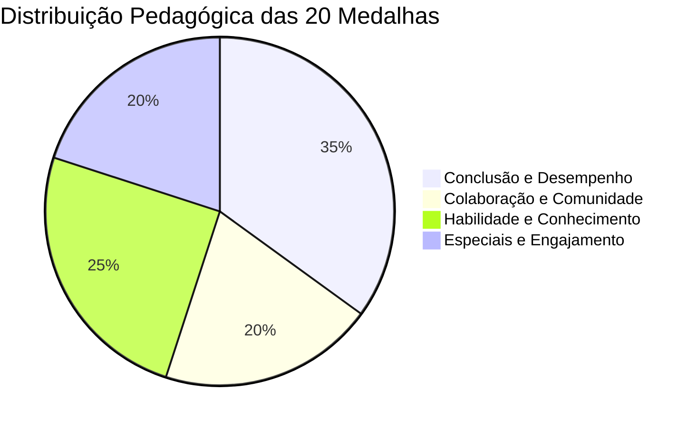

# Catálogo Oficial de Medalhas e Conquistas (20 Badges)

Este catálogo documenta as **20 medalhas oficiais** do **Portal GamificaEdu**, extraídas de `Sistema de Medalhas e Conquistas.docx`. As medalhas são distribuídas em 4 categorias pedagógicas concebidas para estimular competência, autonomia e relacionamento social (SDT).

---

## 1. Visão Geral das Categorias

---

## 2. Categoria 1: Conclusão e Desempenho (7 Medalhas)

Medalhas voltadas ao rigor acadêmico, persistência, maestria e superação pessoal.

| # | Código | Nome da Medalha | Critério de Desbloqueio | Recompensa | Finalidade Pedagógica |
|---|---|---|---|---|---|
| 1 | `INSPECTOR` | **Inspetor** | Obter 100% de acerto na primeira tentativa em todos os quizzes de uma atividade | +100 XP / +50 Moedas | Incentivar a leitura atenta antes de responder |
| 2 | `KEY_PIECE` | **Peça-Chave** | Superar um nó de desafio complexo rotulado como bloqueador | +150 XP / +75 Moedas | Recompensar a persistência em problemas difíceis |
| 3 | `EXPLORER` | **Explorador** | Concluir 100% dos nós (obrigatórios e opcionais) de um tabuleiro | +200 XP / +100 Moedas | Estimular a autonomia e exploração extracurricular |
| 4 | `DIAMOND_EXCELLENCE` | **Diamante de Excelência** | Atingir nota máxima em todas as atividades do semestre | +500 XP / +250 Moedas | Reconhecer a consistência de longo prazo |
| 5 | `SPEEDSTER` | **Velocista** | Concluir uma trilha figurando entre os 10% mais rápidos com >= 80% de acerto | +120 XP / +60 Moedas | Dinamismo com precisão conceitual |
| 6 | `MARATHONER` | **Maratonista** | Acessar o sistema e concluir atividades em 7 dias consecutivos | +150 XP / +100 Moedas | Criação de hábitos diários de estudo |
| 7 | `PHOENIX` | **Fênix** | Recuperar o desempenho em uma matéria saindo de <50% para >90% de acerto | +250 XP / +150 Moedas | Resiliência pedagógica e combate à evasão |

---

## 3. Categoria 2: Colaboração e Comunidade (4 Medalhas)

Medalhas estruturadas para fomentar o aprendizado entre pares e o espírito coletivo.

| # | Código | Nome da Medalha | Critério de Desbloqueio | Recompensa | Finalidade Pedagógica |
|---|---|---|---|---|---|
| 8 | `TEAM_SPIRIT` | **Espírito de Equipe** | Concluir uma atividade em grupo com avaliação positiva de todos os membros | +150 XP / +80 Moedas | Desenvolver soft skills e trabalho colaborativo |
| 9 | `KNOWLEDGE_SOWER` | **Semeador do Saber** | Ter 5 respostas no Fórum de Dúvidas marcadas como "Melhor Resposta" | +200 XP / +120 Moedas | Transformar alunos avançados em mentores |
| 10 | `CONNECTOR` | **Conector** | Convidar e integrar 3 colegas de classe para uma equipe de estudos ativa | +100 XP / +50 Moedas | Fortalecer a rede social de apoio da turma |
| 11 | `AMBASSADOR` | **Embaixador** | Compartilhar certificados ou conquistas com a comunidade institucional | +80 XP / +40 Moedas | Divulgar a cultura de excelência acadêmica |

---

## 4. Categoria 3: Habilidade e Conhecimento (5 Medalhas)

Focadas no domínio profundo das disciplinas e na aplicação prática interdisciplinar.

| # | Código | Nome da Medalha | Critério de Desbloqueio | Recompensa | Finalidade Pedagógica |
|---|---|---|---|---|---|
| 12 | `KNOWLEDGE_ARCHITECT` | **Arquiteto do Saber** | Concluir a trilha completa de fundamentos teóricos de Engenharia de Software | +180 XP / +90 Moedas | Consolidação das bases epistemológicas |
| 13 | `SYNERGY` | **Sinergia** | Realizar projeto interdisciplinar combinando programação e design | +200 XP / +100 Moedas | Quebra de silos de conhecimento |
| 14 | `INNOVATOR` | **Inovador** | Propor solução de código com nota máxima de originalidade na avaliação docente | +250 XP / +150 Moedas | Fomentar o pensamento crítico e a criatividade |
| 15 | `POLYMATH` | **Polímata** | Finalizar atividades em 3 grandes áreas distintas do conhecimento | +300 XP / +180 Moedas | Formação ampla e versatilidade técnica |
| 16 | `MASTER` | **Mestre** | Concluir com louvor uma trilha especialista avançada de pós-graduação | +400 XP / +200 Moedas | Reconhecimento de maestria sênior |

---

## 5. Categoria 4: Especiais e Engajamento (4 Medalhas)

Medalhas que celebram a lealdade à plataforma, a curiosidade epistemológica e a descoberta.

| # | Código | Nome da Medalha | Critério de Desbloqueio | Recompensa | Finalidade Pedagógica |
|---|---|---|---|---|---|
| 17 | `PIONEER` | **Pioneiro** | Figurar entre os 10 primeiros alunos a concluir uma nova atividade lançada | +150 XP / +75 Moedas | Estimular o entusiasmo e engajamento inicial |
| 18 | `CURIOUS` | **Curioso** | Formular 10 dúvidas bem fundamentadas que geraram discussões ativas no fórum | +120 XP / +60 Moedas | Valorizar a capacidade socrática de perguntar |
| 19 | `VETERAN` | **Veterano** | Completar 1 ano letivo com atividade constante na plataforma | +350 XP / +200 Moedas | Fidelização e retenção escolar de longo prazo |
| 20 | `TREASURE_HUNTER` | **Caçador de Tesouros**| Descobrir 3 conteúdos secretos ou desafios bônus escondidos no tabuleiro | +200 XP / +150 Moedas | Despertar o prazer pela exploração livre (Hexad) |

---

## 6. Integridade e Idempotência

- **Unicidade:** O banco de dados garante via restrição `UNIQUE(user_id, medal_id)` que nenhuma medalha seja concedida mais de uma vez para o mesmo estudante.
- **Rastreabilidade Forense:** Toda conquista registra o timestamp exato em `user_unlocked_medal.unlocked_at` e dispara um evento unificado em `EventLog`.
