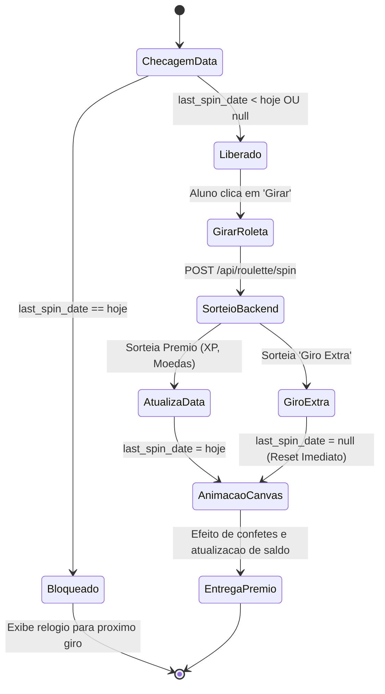

# Mecânicas do Tabuleiro de Jogo e Minijogo da Roleta

Este documento especifica a interface e as regras operacionais do **Tabuleiro de Jogo Interativo** e da **Roleta Diária da Sorte**, abordando a substituição da lista de cards (**ADR-009**), o overlay modal imersivo (**ADR-008**), o pré-carregamento de assets (**ADR-010**) e a construção nativa da roleta (**ADR-012**).

---

## 1. A Metáfora do Tabuleiro de Jogo

Em substituição às listas estáticas de LMS tradicionais, o Portal GamificaEdu adota uma metáfora espacial de trilha gráfica onde cada atividade é um mapa interativo:

```mermaid
graph LR
    Start((Início)) --> Node1[Step 1: Vídeo Conceitual<br><i>LearningContent</i>]
    Node1 --> Node2{Step 2: Quiz de Lógica<br><i>Obrigatório</i>}
    Node2 -->|Caminho Principal| Node3[Step 3: Narrativa de Cenário<br><i>NarrativeContent</i>]
    Node2 -.->|Rota Bônus Opcional| NodeBonus[Step 2B: Desafio Avançado<br><i>Opcional (+50 Moedas)</i>]
    Node3 --> Node4{Step 4: Avaliação Final<br><i>Obrigatório</i>}
    NodeBonus --> Node4
    Node4 --> Finish(((Conclusão / Troféu)))
```

### 1.1 Estados dos Nós do Tabuleiro
Cada passo no tabuleiro transita por 4 estados visuais distintos renderizados dinamicamente:
1. **Bloqueado (Locked):** O nó pré-requisito não foi concluído. Exibido em escala de cinza com ícone de cadeado. Interação desabilitada.
2. **Liberado / Atual (Current):** O próximo passo da trilha. Exibido com borda brilhante e pulso de animação CSS (`animate-pulse`).
3. **Concluído (Completed):** Passo já executado com sucesso. Exibido com check dourado e selo de pontuação obtida. Pode ser revisitado para revisão.
4. **Opcional / Bônus (Optional):** Passo ramificado marcado pelo professor como não mandatório (ADR-018). Concede moedas extras, mas não impede a conclusão final da atividade.

### 1.2 Cena Imersiva e Overlay Modal (ADR-008)
Ao clicar em um nó, na Loja ou no Fórum, o sistema não descarrega o mapa. O componente `ActivityViewOverlay` abre o conteúdo em uma janela translúcida central enquanto o tabuleiro permanece visível ao fundo com desfoque gaussiano suave (`backdrop-blur-md`). Isso mantém a **presença contextual** do estudante dentro da jornada de jogo.

### 1.3 Pré-Carregamento Centralizado de Assets (ADR-010)
O hook `useAssetLoader` pré-carrega todas as texturas, fundos de tela, ícones e áudios na inicialização de `ActivityPage.jsx`, garantindo **zero pop-in de imagens** e navegação fluida em menos de 16ms (60 FPS).

---

## 2. Minijogo da Roleta Diária da Sorte (ADR-012 e ADR-023)

A Roleta Diária da Sorte é um mecanismo de estímulo ao hábito de retorno diário à plataforma.



### 2.1 Regras de Operação e Probabilidade
- **Frequência:** 1 giro gratuito a cada dia civil (baseado no fuso horário do servidor).
- **Construção Nativa (ADR-012):** Desenvolvida em HTML5 Canvas nativo com interpolação de Bézier cúbica no CSS, sem dependências npm obsoletas conflitantes com React 19.
- **Tabela de Probabilidades do Backend:**
  - 40% de chance: +20 a +50 Moedas de Sabedoria.
  - 35% de chance: +50 a +100 Pontos de Experiência (XP).
  - 15% de chance: +100 Moedas (Prêmio Grande).
  - 10% de chance: **Giro Extra Imediato**.

### 2.2 Tratamento da Premiação "Giro Extra" (ADR-023)
Conforme a Decisão de Engenharia 004.4/023, o prêmio "Giro Extra" é implementado sem criar itens complexos de inventário:
- Ao cair no setor "Giro Extra", o backend simplesmente **reseta o campo `last_spin_date = NULL`** na sessão atual do aluno.
- Isso permite que o estudante acione a roleta novamente no mesmo instante, simplificando o código e eliminando riscos de descompasso de dados no banco.
