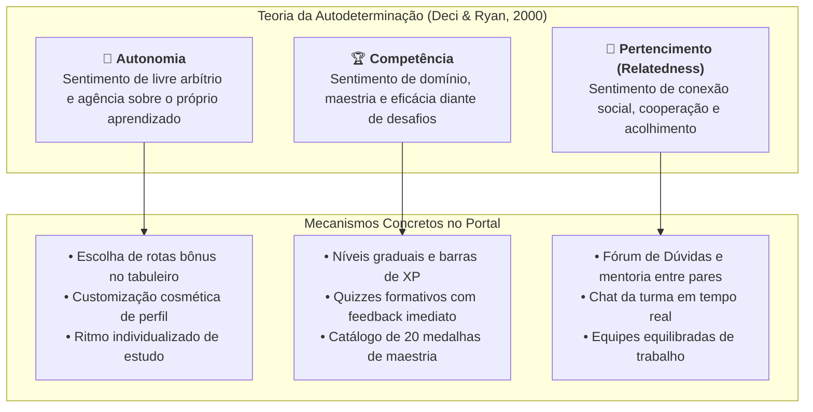
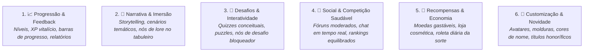
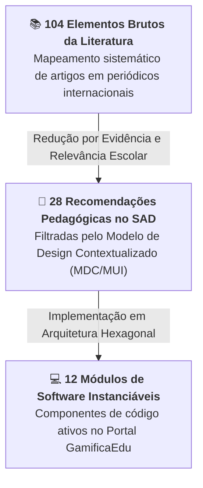

# Heurísticas Pedagógicas, Framework MDA e Teoria da Autodeterminação

Este documento fundamenta teoricamente a aplicação de gamificação no **Portal GamificaEdu**, articulando o **Framework MDA (Mechanics, Dynamics, Aesthetics)**, a **Teoria da Autodeterminação (SDT)** de Deci & Ryan, os **6 Grupos de Elementos de Gamificação** e o **Funil de Redução de Dados** da tese de doutorado.

---

## 1. Os Três Pilares da Teoria da Autodeterminação (SDT)

A gamificação pedagógica autêntica não se apoia em coerção comportamentalista, mas no florescimento da **motivação intrínseca** por meio do suporte a três necessidades psicológicas básicas:

---

## 2. O Framework MDA Aplicado ao Ensino

O design de jogos educacionais opera a ponte entre a visão do professor (designer) e a experiência do estudante (jogador):

1. **Mecânicas (Mechanics):** As regras formais, algoritmos e componentes do sistema (ex: nós do tabuleiro, quizzes com alternativas, roleta em canvas, saldo de XP/moedas).
2. **Dinâmicas (Dynamics):** Os comportamentos emergentes que surgem quando os estudantes interagem com as mecânicas ao longo do tempo (ex: cooperação para resolver problemas difíceis, formação de grupos de estudo, competição saudável por precisão).
3. **Estética (Aesthetics):** As respostas emocionais e psicológicas cultivadas no discente (ex: sensação de descoberta e exploração, alívio e orgulho ao superar um desafio, camaradagem com colegas).

---

## 3. Os 6 Grupos de Elementos de Gamificação

Extraído do documento original de design (`Documento de Design do Ambiente Gamificado.docx`), o portal organiza suas mecânicas em seis grupos funcionais:

1. **Progressão e Feedback:** Fornece retorno transparente e instantâneo sobre o desenvolvimento cognitivo do estudante, sustentando a percepção de competência.
2. **Narrativa e Imersão:** Envolve o aluno em uma jornada temática coerente, transformando exercícios abstratos em missões de exploração.
3. **Desafios e Mecânicas Interativas:** Calibra o grau de desafio na "Zona de Desenvolvimento Proximal" (Vygotsky) e no "Canal de Flow" (Csikszentmihalyi).
4. **Social e Competição Saudável:** Fomenta o suporte mútuo e canaliza a competição para a auto-superação, mitigando rivalidades nocivas através de mediação pedagógica.
5. **Recompensas e Economia:** Estimula o engajamento através de incentivos virtuais desvinculados de notas punitivas.
6. **Customização e Novidade:** Garante a auto-expressão do estudante, permitindo que cada discente construa sua identidade visual no ecossistema escolar.

---

## 4. O Funil de Redução de Dados da Tese (Funil MDA)

A tese de doutorado estrutura a ponte entre a vasta literatura de gamificação e a implementação em software através de um funil de três etapas:

- **104 Elementos na Literatura:** O corpus inicial de elementos descritos na literatura científica de gamificação.
- **28 Elementos no Sistema de Apoio à Decisão:** Elementos selecionados com comprovação empírica em educação para avaliação de compatibilidade algorítmica pelo MRC.
- **12 Módulos de Software no Portal:** Componentes plenamente codificados e operacionais no MVP (Tabuleiro, Quiz, Narrativa, Loja, Inventário, Perfil, Roleta, Ranking, Fórum, Chat, Analytics, Assistente de IA).
