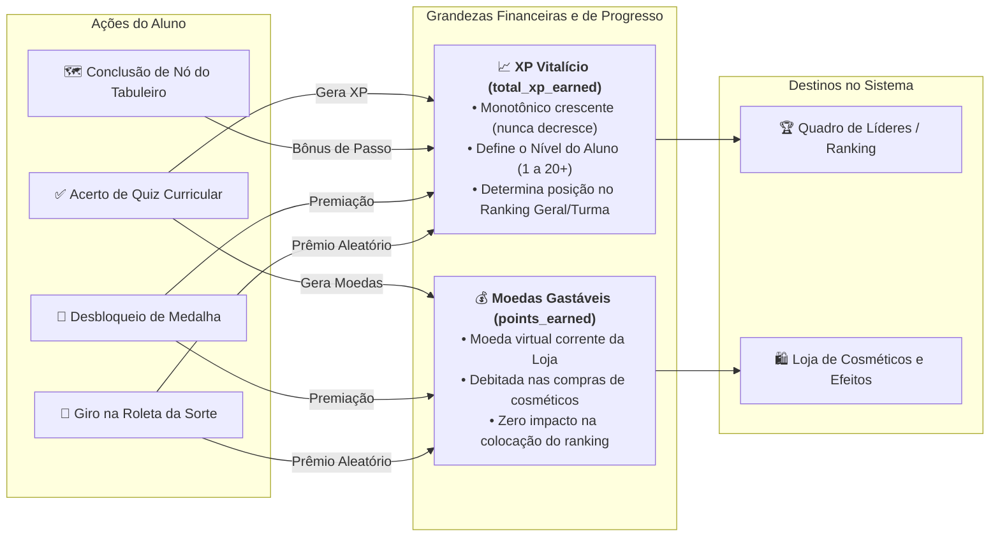

# Sistema de Pontuação, Níveis e Economia Dupla (XP vs Moedas)

Este documento especifica a mecânica de progressão e a economia matemática do **Portal GamificaEdu**, implementando os princípios de game design educacional fundamentados na Teoria da Autodeterminação (SDT) e consolidando a decisão de engenharia de separação de moedas (**ADR-004**).

---

## 1. Princípio da Economia Dupla (Dual Currency Model)

Para evitar distorções comportamentais e garantir a justiça acadêmica, o sistema opera com duas grandezas matemáticas completamente desacopladas:

### 1.1 `total_xp_earned` (Pontos de Experiência Vitalícios)
- **Natureza:** Acumulador perpétuo e irreversível de competência cognitiva.
- **Função:** Determina a curva de progressão de níveis e a classificação nos murais de liderança da turma e da instituição.
- **Invariante:** Nunca é subtraído ou resetado por compras, transações ou trocas.

### 1.2 `points_earned` (Moedas Virtuais Gastáveis)
- **Natureza:** Unidade de poder de compra na Loja de Recompensas ("Pontos de Sabedoria").
- **Função:** Concedida proporcionalmente ao mérito acadêmico em quizzes (ADR-019), permitindo ao aluno adquirir itens cosméticos, molduras de avatar, auras e títulos honoríficos.
- **Invariante:** Validação estrita server-side: nenhuma compra é autorizada se `points_earned < item.price_coins`.

---

## 2. Curva Matemática de Níveis (Leveling Progression)

A transição entre níveis adota uma progressão aritmética calibrada em `backend/app/domain/gamification_rules.py`:

### 2.1 Equação de XP por Nível
O XP necessário para progredir do nível atual $L$ para o nível subsequente $L+1$ é dado por:

$$XP_{passo}(L) = 	ext{BASE\_XP} + (L - 1) 	imes 	ext{LEVEL\_STEP\_XP}$$

Onde:
- $	ext{BASE\_XP} = 100$
- $	ext{LEVEL\_STEP\_XP} = 50$

### 2.2 Tabela de Progressão de Níveis (Níveis 1 a 15)

| Nível ($L$) | Título Honorífico | XP para Subir ($XP_{passo}$) | XP Total Acumulado ($XP_{acum}$) | Recompensa de Level-Up |
|---|---|---|---|---|
| **1** | Aprendiz Iniciante | 100 XP | 0 XP | Desbloqueio da Roleta Diária |
| **2** | Explorador de Código | 150 XP | 100 XP | +50 Moedas na Carteira |
| **3** | Rasteador de Lógica | 200 XP | 250 XP | Moldura de Avatar Bronze |
| **4** | Depurador Ágil | 250 XP | 450 XP | +75 Moedas na Carteira |
| **5** | Arquiteto Júnior | 300 XP | 700 XP | Título "Construtor de Módulos" |
| **6** | Analista de Requisitos | 350 XP | 1.000 XP | +100 Moedas na Carteira |
| **7** | Mestre dos Testes | 400 XP | 1.350 XP | Moldura de Avatar Prata |
| **8** | Engenheiro de Refatoração | 450 XP | 1.750 XP | +150 Moedas na Carteira |
| **9** | Designer de Padrões | 500 XP | 2.200 XP | Aura Visual "Chama Azul" |
| **10** | Especialista SWEBOK | 550 XP | 2.700 XP | Título "Polímata da Engenharia" |
| **11** | Estrategista de Qualidade | 600 XP | 3.250 XP | Moldura de Avatar Ouro |
| **12** | Consultor de Arquitetura | 650 XP | 3.850 XP | +250 Moedas na Carteira |
| **13** | Líder de Equipe Ágil | 700 XP | 4.500 XP | Efeito de Nome "Ouro Dourado" |
| **14** | Auditor de Sistemas | 750 XP | 5.200 XP | +300 Moedas na Carteira |
| **15** | Grão-Mestre da Gamificação | 800 XP | 5.950 XP | Moldura Arcana Diamante |

---

## 3. Matriz de Recompensas por Atividade Curricular

O cálculo de pontos concedidos em quizzes avaliativos segue a função determinística:

$$Pontos_{quiz} = \left\lfloor rac{Q_{corretas}}{Q_{total}} 	imes 	ext{Base\_XP} 
ight
floor$$

- **Acerto Perfeito (100%):** Concede bônus extra de +25% de moedas e elegibilidade para a medalha "Inspetor".
- **Tentativas Subsequentes:** Em caso de refações permitidas pelo docente, a pontuação de XP vitalício absorve apenas o delta positivo entre a nota anterior e a nova nota, prevenindo farm artificial de XP.
