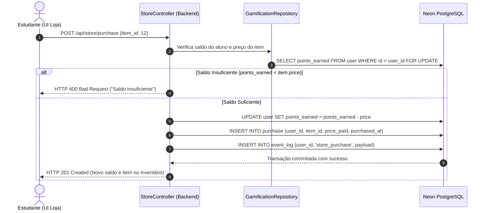

# Economia da Loja de Recompensas e Gestão de Cosméticos

Este documento estabelece as regras de negócio, a precificação balanceada e a arquitetura técnica da **Loja de Recompensas** do Portal GamificaEdu, detalhando os itens cosméticos do MVP e a alocação de itens utilitários no backlog (**ADR-005** e **ADR-023**).

---

## 1. Diretrizes Econômicas do MVP

1. **Foco Estrito em Itens Cosméticos (ADR-023):**
   - No MVP, a loja comercializa exclusivamente personalizações visuais: molduras de avatar, auras animadas, estilos de nome e títulos honoríficos.
   - Itens utilitários de power-up ("Dica extra", "Segunda chance", "Congelar tempo") foram postergados para a versão 1.1 para preservar a integridade das avaliações no lançamento.
2. **Backend-Driven Architecture (ADR-005):**
   - Toda verificação de posse, dedução de moedas e verificação de expiração temporal de efeitos ocorre no servidor. O frontend é uma casca visual que renderiza dados autorizados pela API.
3. **Equilíbrio Inflacionário:**
   - O volume de moedas ganho em um semestre letivo regular permite a um aluno dedicado adquirir entre 2 a 4 cosméticos raros, mantendo o valor percebido de prestígio.

---

## 2. Catálogo Oficial de Itens e Preços

### 2.1 Molduras de Avatar (Frames)

| Item | Tipo | Preço (Moedas) | Duração | Descrição Visual |
|---|---|---|---|---|
| **Moldura de Madeira Rústica** | Frame | 50 moedas | Permanente | Borda clássica de madeira polida |
| **Moldura de Bronze Polido** | Frame | 100 moedas | Permanente | Acabamento metálico em bronze escovado |
| **Moldura de Prata dos Mestres** | Frame | 200 moedas | Permanente | Prata radiante com runas estilizadas |
| **Moldura de Ouro Imperial** | Frame | 400 moedas | Permanente | Ouro puro com brilho dourado sutil |
| **Moldura Arcana Diamante** | Frame | 750 moedas | Permanente | Cristal facetado com partículas cintilantes |

### 2.2 Estilos e Cores de Nome no Placar (Name Colors)

| Item | Tipo | Preço (Moedas) | Duração | Descrição Visual |
|---|---|---|---|---|
| **Nome Azul Ciano** | NameColor | 80 moedas | Permanente | Tipografia vibrante em ciano elétrico |
| **Nome Roxo Cósmico** | NameColor | 150 moedas | Permanente | Púrpura galáctico para nomes em destaque |
| **Nome Esmeralda Neon** | NameColor | 250 moedas | Permanente | Verde neon intenso |
| **Nome Gradiente Dourado** | NameColor | 500 moedas | Permanente | Gradiente animado em tons de amarelo e ouro |

### 2.3 Títulos de Prestígio (Honorific Titles)

| Item | Tipo | Preço (Moedas) | Duração | Descrição / Efeito |
|---|---|---|---|---|
| **O Observador** | Title | 60 moedas | Permanente | Título discreto exibido abaixo do nome |
| **Arquiteto de Software** | Title | 180 moedas | Permanente | Exibição de prestígio acadêmico |
| **Caçador de Bugs** | Title | 250 moedas | Permanente | Para alunos com foco em qualidade e testes |
| **Mestre dos Padrões (GoF)** | Title | 450 moedas | Permanente | Reconhecimento de maestria em design OO |

### 2.4 Efeito Especial Temporário: "Topo por um Dia" (ADR-005)

- **Preço:** 300 moedas.
- **Duração:** 24 horas consecutivas a partir do momento da compra.
- **Comportamento no Backend:**
  - O registro em `purchase` recebe `expires_at = now() + INTERVAL '24 hours'`.
  - Quando a API `/api/rankings` é consultada pelo titular, o backend inclui a flag `blur_competitors: true`, fazendo com que a UI aplique um filtro gaussiano de desfoque (`filter: blur(4px)`) sobre os nomes dos concorrentes no mural da turma, mantendo apenas o comprador em nitidez luminosa no topo da visão.
  - Ao expirar as 24 horas, o efeito cessa automaticamente sem intervenção manual.

---

## 3. Fluxo de Transação Segura de Compra

