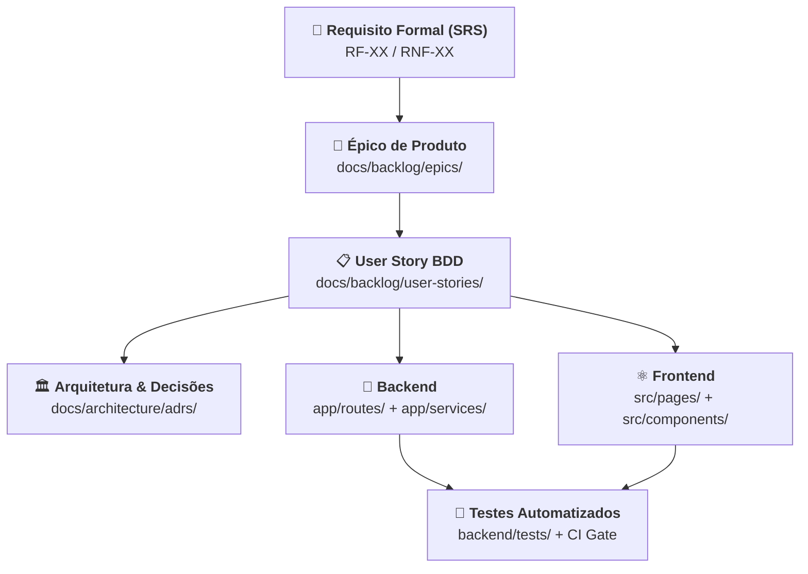

# Engenharia de Requisitos e Rastreabilidade — GamificaEdu

Este diretório estabelece o núcleo formal de **Engenharia de Requisitos** do **Portal GamificaEdu**, alinhado com as normas internacionais **ISO/IEC/IEEE 29148:2018** (Engenharia de Requisitos) e **ISO/IEC 25010** (Qualidade de Produto de Software), integrando a visão acadêmica da tese de doutorado em Design Science Research (DSR) com a implementação ágil do repositório.

---

## 1. Estrutura da Seção

```
docs/requirements/
├── README.md   # Este índice e governança de requisitos
├── SRS.md      # Especificação de Requisitos de Software (ISO/IEC/IEEE 29148)
└── RTM.md      # Matriz de Rastreabilidade de Requisitos Bidirecional (RTM)
```

---

## 2. Documentos do Núcleo de Requisitos

| Documento | Padrão / Framework | Finalidade |
| :--- | :--- | :--- |
| **[SRS.md](file:///home/julio/Documentos/projetos/portal-gamificacao-educacional/docs/requirements/SRS.md)** | ISO/IEC/IEEE 29148 / IEEE 830 | Especificação completa do escopo, 15 Requisitos Funcionais (RF-01 a RF-15), 10 Requisitos Não-Funcionais (RNF-01 a RNF-10), regras de negócio e catálogo de atores. |
| **[RTM.md](file:///home/julio/Documentos/projetos/portal-gamificacao-educacional/docs/requirements/RTM.md)** | RTM Bidirecional (Forward & Backward) | Matriz que rastreia cada requisito formal com seu Épico, User Story (BDD), componentes de Backend, Frontend e suíte de testes automatizados no CI/CD. |

---

## 3. Modelo de Rastreabilidade Integrada

A governança do projeto estabelece que nenhuma funcionalidade existe sem rastreabilidade bidirecional ponta a ponta:



---

## 4. Governança e Controle de Mudanças

1. **Alterações em Requisitos:** Qualquer nova demanda ou mudança de regra de negócio deve ser primeiramente formalizada no `SRS.md`, desdobrada nas User Stories (`docs/backlog/user-stories/`) e mapeada na matriz `RTM.md`.
2. **Critério de Pronto (DoD):** Um requisito só é considerado com status `VERIFIED` quando seus cenários BDD contam com cobertura de testes automatizados passando na esteira de CI.
3. **Auditoria de Conformidade:** Verificações periódicas asseguram que nenhum código órfão exista no backend ou frontend sem correspondência na matriz RTM.
